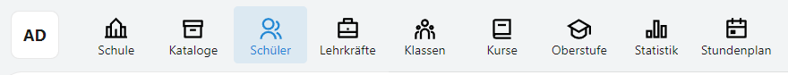
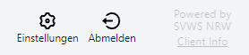

# Die Apps, die Programmoberfläche des SVWS-Clients

Die großen Programmteile im SVWS-Client heißen **Apps**.

Mit diesen werden die Schule, die Schülerschaft Lehrkräfte und so weiter verwaltet.

Je nach Bildschirmbreite können die Apps als Menü **oben** oder **links** im Browser angezeigt werden.

Die App-Leiste beginnt immer zuerst mit dem akuell angemeldeten Benutzer, hier im Screenshot *AD* für den "Admin", dann folgen die weiteren Apps.

Je nach Schulform werden bei Ihnen eventuell Apps ausgeblendet oder weitere Apps werden eingeblendet.

Die Knöpfe für die **Einstellungen** und das **Abmelden** finden sich am Ende der App-Leiste.

Ganz am Ende lässt sich über **Client Info** die installierte Version des Clients abrufen.

Über die Client-Info erreichen Sie ebenfalls das **Impressum** und die **Hinweise zum Datenschutz**.

::: tip Was sind diese Artikel?
In diesen Artikel werden die **Apps** und ihre **Tabs** und eventuell vorhandenen **Untertabs** in der Breite und Tiefe ihrer jeweiligen Funktionalitäten beschrieben.
Daraus folgt, dass es sich mitunter um keine prozessbezogenen Verfahrensanleitungen handeln kann, die für einen Prozess "gerade herunter gearbeitet" werden können. Diese Artikel sind darauf ausgelegt, zur Erstorientierung komplett gelesen zu werden beziehungsweise zum späteren Nachschlagen von einzelnen Aspekten aufgerufen zu werden.

Prozessbezogene Verfahrensanleitungen finden Sie im Bereich der **Anleitungen** im Inhaltsverzeichnis.
:::