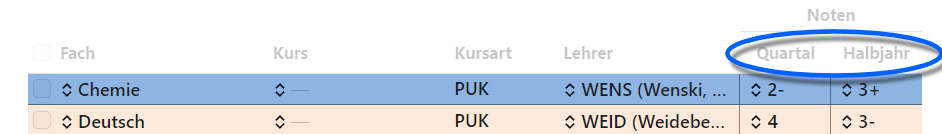

# Grundlegende Änderungen im Konzept des SVWS-Clients

Der SVWS-Client ist eine Möglichkeit, mit einem Internetbrowser auf den schulischen Datenbestand zuzugreifen.

An dieser Stelle werden wesentliche Änderungen in Bedienung und Konzept der neuen Schulverwaltungssoftware erläutert.

Der Artikel zur `Bedienung im Browser`, zu erreichen im Inhaltsverzeichnis links, führt durch die neue Oberfläche.

## Verwaltung in einer abschnittsbezogenen Klassentabelle

Bisher war es in SchILD-NRW 2 nicht möglich, die **Historie von Klassen** zu speichern, nun werden Klassen für jeden Lernabschnitt mit ihren Daten angelegt.

Die Schuljahresabschnitte werden mit eindeutigen IDs gespeichert, welche in der Tabelle der Klassen für alle Lernabschnitte mit Ihren Klassenlehrkräften und den weiteren Angaben abgelegt werden.

Somit ist es nun möglich, für Klassen rückblickend zum Beispiel die Lehrkräfte oder die Zusammensetzung der Schülergruppe einzusehen.

## Planung eines zukünftigen Lernabschnitts

Außerdem wird es ermöglicht, die **Planung eines kommenden Lernabschnitts** vorzunehmen. Sie können somit Klassen und auch Kurse mit ihren Belegungen schon für das nächste Schuljahr vornehmen.

## Stundenplanverwaltung und Unterrichtsverteilung

SVWS-Server und SVWS-Client erlauben nun die Verwaltung eines Stundenplans für die Schülerinnen und Schüler.

Ebenso wird die Unterrichtsverteilung im SVWS-Client erfasst.

## Erfassen Sie die Quartalsnoten direkt im Lernabschnitt eines Halbjahres

Quartale werden nicht mehr als eigene Lernabschnitte geführt.

Quartalsnoten lassen sich direkt im **aktuellen Lernabschnitt** erfassen. Hierfür steht neben der Spalte für die *Note* eine neue Spalte für die *Quartal*snote zur Verfügung.

## Erfassung der Statistikdaten mit dem SVWS-Client

Die Statistik der amtlichen Schuldaten wird über den SVWS-Client erhoben. Damit werden auch alle Statistikprüfungen, die bislang im Statistikprogramm durchgeführt wurden, jederzeit im SVWS-Client ausgeführt.

## Markierung von Schülern

Schüler und Schülerinnen werden über die Checkboxen auf eine Art markiert, um dann auf dieser Gruppe weitere Funktionen auszuführen.

## Konzept zum Druck aus dem SVWS-Client

Der SVWS-Client bietet die Möglichkeit, Listen oder Schulbescheinigungen direkt aus dem SVWS-Client zu erzeugen.