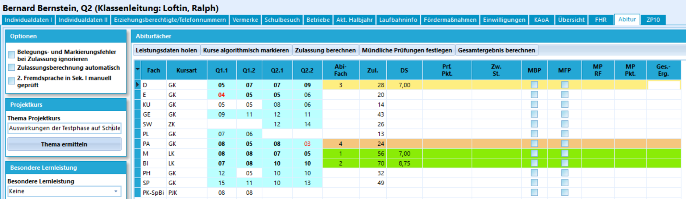
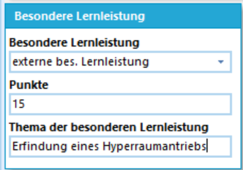
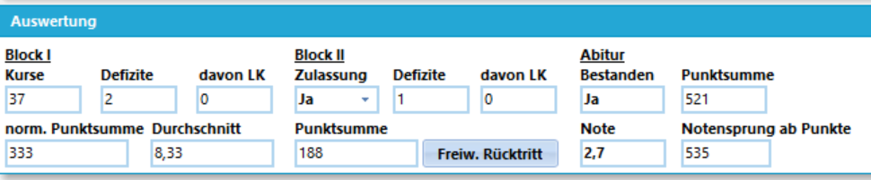

# Abitur

Der Abiturprozess folgt diesem Ablauf
:
1. Die Zulassung zur Abiturprüfung basiert auf den Leistungen der Q-Phase. Über die Zulassungen entscheidet der 1. Zentrale Abiturausschuss (ZAA) anhand der in der APO GOSt festgelegten Kriterien.
2. Wird die Zulassung erreicht, werden die Abiturprüfungen geplant. Hierbei treten die Fachprüfungsausschüsse der Prüfungskomissionen zusammen.
3. Im Anschluss werden bei Bedarf Bestehensprüfungen und bei Wunsch Freiwillige Mündliche Prüfungen angesetzt. Die Ergebnisse werden vom 2. ZAA ausgewertet und den Schülerinnen und Schülern bekanntgegeben.
4. Im Anschluss an alle Prüfungen werden die Ergebnisse im 3. ZAA zusammengeführt und die Endauswertung findest statt. Bei Bestehen des Abiturs wird die Allgemeine Hochschulreife anerkannt.
5. Drucken Sie die Abschluss- und Abgangszeugnisse und geben Sie diese aus.
6. Führen Sie die notwendigen Schritte über der Schülermenge in der Datenbank aus: die meisten gehen in den Abschluss, einige werden Abgänger, andere wiederholen.

```` mermaid
flowchart LR
     A --Keine Zulassung--> C{Freie Entscheidung oder<br>Notwendigkeit des Abgangs}
     C --Wiederholung--> E(Verbleib oder<br>Schulwechsel)
     C --Abgang----> D>Verlassen Ihrer<br>Schule]
     A[(Leistungen der Q-Phase)] ==Zulassung (1. ZAA)==> F{Abiturprüfungen}
     F --Nichtbestehen--> D
     F ==Bestehensprüfung==> G{Weitere Prüfung}
     F -.(Freiwillige Prüfung).-> G
     G --> D
     F ==Bestehen===> H>3. ZAA<br>Abitur]
     G ==Erfolg==> H
````

## Der Rechtsrahmen

Als Oberstufenkoordination oder deren Vertretung ist es empfehlenswert, an dieser Stelle die relevanten Rechtstexte zu lesen. Wenn es um Beschlussfähigkeiten, Berechtigungen, Rücktritte, Wiederholungen, Zulassungen, Zeugnisformulare und so weiter kommt es genau auf die rechtlichen Details an, die sich in dieser technischen Anleitung nicht rechtsverbindlich darstellen lassen.

```` mermaid
     flowchart LR
          A(Dieses Handbuch<br>lesen) --> B(APO GOSt<br>SchuLG<br>usw.) --> C(Weiter mit diesem Handbuch)
````

## Abitur mit SchILD NRW 3

Die Verwaltung des Abiturs wird mit SchILD-NRW 3 durchgeführt. Im SVWS-Client wird derzeit gerade ebenfalls der Abiturprozess entwickelt und wird zukünftig als Alternative oder Ersatz zu SchILD-NRW 3 bereitstehen.

::: tip APO GOSt
Alle Screenshots werden mit einem Jahrgang der "alten" APO GOSt erzeugt. Sobald diese Jahrgänge auslaufen, werden die Screenshots auf die APO GOSt (2027) umgestellt.
:::

Wählen Sie zuerst im Schülercontainer exklusiv Ihre Q2 an, damit der Reiter **Abitur** zur Verfügung steht.

Die Vorbereitungen für das Abitur sind bei der Verarbeitung der Leistungsdaten behandelt worden. Zum Abitur gibt es hier keinen Unterschied.

Kontrollieren Sie, 
* die korrekten Konferenz- und Zeugnisdaten gesetzt sind, 
* dass alle Leistungsdaten vorhanden sind und
* dass die Sprachenfolge letztmalig aktualisiert wurde.
* Denken Sie daran, an die **Projektkurstehmen** in die *fachbezogenen Bemerkungen* einzutragen.
* Sammeln Sie rechtzeitig eventuelles *Außerunterrichtliche Engagement* und Mitarbeit in der *Schülervertreitung* oder vergleichbar zusammen.

::: tip Fragen Sie Abiturientendaten ab
In der Praxis kann zur Vorbereitung des Abiturprozesses auch eine *Abfrage der Abiturientendaten* stattfinden. Sind die Namen - die können sich durchaus ändern - aktuell und genauso wie auf der *Geburtsurkunde* oder anderen Beurkundungen einer Namensänderung? Ist das *Geburtsdatum* garantiert korrekt und wie auf der Geburtsurkunde? Soll die *Konfession* mit auf das Zeugnis gedruckt werden oder nicht (dies wird über einen Haken in den *Individualdaten* gesteuert).
:::



Das Abitur wird zum größten Teil über diesen Reiter verwaltet, der auch über *Gruppenprozesse* befüllt werden kann.

### Der Bereich Abiturfächer

Im Reiter Abitur sind die *Unterreiter* unter **Abiturfächer** zu beachten. Von links nach rechts bilden diese den Weg zum Abitur ab. 
* Zuerst werden die Leistungsdaten aus den Lernabschnitten geholt,
* dann werden die einzubringenden Kurse markiert. Mit einem `Doppelklick` können Sie Markierungen an- und abwählen. Der Algorithmus ist grundsätzlich sehr fähig, die für die Schülerinnen und Schüler beste Kombination zu finden, dennoch müssen Sie alle Wahlen persönlich kontrolliert sein.
* Anschließend wird die Zulassung berechnet. Das Kürzel der Spalte **Zul.** ist die gewichtete Punktsumme, hier im Beispiel GKs einfach und LKs doppelt und die Spalte **DS** ist der Durchschnitt in *Punkten*.
* die Prüfungsergebnisse eingetragen, diese finden sich in der Spalte **Prf. Pkt**, wieder in Punkten. UNter **Zw. St.** finden Sie die *Zwischenstand* in gewichtiten Abiturpunkten.
* Es schließen sich die *Mündlichen Prüfungen* an, die als *Bestehensprüfungen* (**MBP**) oder freiwillig **MFP** angesetzt werden. Die Schülerinnen und Schüler, die in diese Prüfungen gehen, sollten über mögliche Ergebnisse - jeweils die Verbesserungen oder auch möglichlichen Verschlechterungen durch Prüfungsergenisse - beraten werden. Sie legen nun eine möglichst sinnvolle Reihenfolge für die mündlichen Prüfungen fest (**MP RF**), die den größten Erfolg mit den wenigsten Prüfungen verspricht. In der Spalte **MP Pkt.** werden dann die Ergebnisse eingetragen.
* Am Ende findet sich unter **Ges. Erg.** das *Gesamtergebnis*.

::: tip Achten Sie auf Aktualität der Leistungsdaten
Beachten Sie, dass der Reiter Abitur nur aktualisiert wird, wenn Sie die **Leistungsdaten holen**. Werden also in der Zwischenzeit noch einmal Ergebnisse in den Leistungsdaten verändert, wird der Reiter *nicht* automatisch aktualisiert. 
:::

:: tip Das Holen von Leistungsdaten überschreibt alle Änderungen
Wenn Sie auf **Leistungsdaten holen** klicken, werden *alle* Änderungen und Eintragungen im Reiter Abitur überschrieben. Damit wären schon eingetragene Prüfungsergebnisse gelöscht. Diese Löschung wird auch vorgenommen, wenn Sie die Daten per *Gruppenprozess* aktualisiert werden. Achten Sie also unbedingt darauf, dass *erst* alle Leistungsdaten von allen Schülern aktuell sind - und dass dann *niemand im Oberstufen-Team* mehr die Leistungsdaten in den Reiter Abitur holen möchte.

Immerhin wird noch eine Warnung generiert, die mit *"OK"* zu bestätigen ist. Klicken Sie auf `Zulassung berechnen`, nachdem Prüfungsergebnisse eingetragen sind, werden diese *ohne Warnung* gelöscht!

Passiert das doch jemandem, ist die Strafe mindstens eine Tüte Gummibärchen!
::: 

### Der linke Bereich

Auf der linken Seite werden unter **Option** zwei Möglichkeiten angeboten, die automatische Prüfungen zu ignorieren.

Unter **Belegungs- und Zulassungsfehler ignorieren** können Sie eine Zulassung manuell erzeugen, so dass auch für jemand mit Fehlern bei die Berechnung von Prüfungsergebnissen und die Gesamtprüfung durchgeführt werden kann.

Ein Anwendungsfall könnte ein mit der Schulaufsicht abgesprochener Einzelfall sein. In diesem Falle wird SchILD-NRW 3 sich einer Dezernenten-Entscheidung nicht entgegen stellen.

Ein andere Fall könnte sein, dass ein technischer Fehler in den Algorithmen nicht die Bearbeitungs des Abiturs mit SchILD-NRW 3 verhindert oder zumindest verzögert.

Mit dem Haken bei **2. Fremdsprache in Sek. I manuell geprüft** können Sie einen Fehler mit der 2. Fremdsprache ignorieren. Dies konnte "früher" vorkommen, wenn ein Fach falsch konfiguriert war. Mit dem SVWS-Server sollte sich dieser Fall aber nicht mehr stellen. Für Einzelfälle, in denen es doch aus welchen Gründen auch immer zu Problemen kommt, lässt sich mit diesem Schalter jedoch ein Blockade durch SchILD umgehen.

Der Schalter **Zulassungsberechnung automatisch** führt bei jedem Holen der Leistungsdaten direkt eine *automatische algorithmische Markierung der Kurse* und die *Zulassungsberechnung* aus. Ob die Funktion sinnvoll ist oder nicht, ist debattierbar. Die hier besprochenen Prozesse werden im Regelfall per Gruppenprozess über den ganzen Jahrgang durchgeführt (siehe weiter unten) und daher ist die Verarbeitung individuell im Reiter nur für Einzelfälle relevant.

Diese Aussage gilt auch für den Bereich **Projektkurs**, die Schaltfläche `Thema ermitteln` holt sich das Projektkursthema aus den *Fachbezogenen Bemerkungen* in den *Leistungsdaten des Faches* der Projektkurs-Halbjahre und wird im Standardfall für alle Schülerinnen und Schüler per *Gruppenprozess* angestoßen.



Wird eine *Besondere Lernleistung* anerkannt, wird dies ebenfalls hier links vorgenommen. Tragen Sie einen Wert für die **Punkte**  und das *Thema* ein und wählen Sie aus dem Dropdownmenü eine Besondere Lernleistung. Per Standard steht der Wert hier auf *keine* und Eingabefelder sind ausgeblendet. Es stehen (aktuell) folgende Arten zur Wahl:
* externe bes. Lernleisung
* Projektkurs ist bes. Lernleistung

Wählen Sie, was nach der APO GOSt zulässig ist.

Unter **Weitere Angaben** ist das **Abiturjahr** und der betreffende Lernabschnitt zu setzen. Das ist ein Feld, das automatisch gesetzt ist und zur Sicherheit einmal per Gruppenprozess zu generieren ist.

### Die Auswertung

In der Fußzeile finden Sie die **Auswertung**, die Stück für Stück von *Block I* über *Block II* hin zum *Abitur* befüllt. Diese Zusammenfassungen sind es, die in den Zentralen Abiturausschüssen zu behandeln sind.



Der *Block I* setzt sich aus den Leistungsdaten der Halbjahre aus der Q-Phase zusammen und führt die *eingebrachten Kurse* in ihrer vorgesehenen Gewichtung auf. Sie sehen unten links die bislang erreichte Abitur-Punktsumme und schließlich das Ergebnis **Zulassung** unter *Block II*. Hier kann auch manuell eine Einstellung vorgenommen werden.

Kommt es zu einem **Freiwilligen Rücktritt** von der Abiturprüfung, klicken Sie auf die entsprechend benannte Schaltfläche.

Zu diesen Zeitpunkt sind die folgenden Felder noch leer.

Erst, wenn Sie die **Prüfungsergebnisse** eingetragen haben, werden diese mit den **Defiziten** und der weiteren **Abitur-Punktsumme** befüllt.

Wurde das Abitur nun schon bestanden, wird das Feld **Abitur Bestanden** mit der Berechnung des Gesamtergebnisses auf *Ja* gesetzt. Ist das Abitur noch nicht bestanden, sind die **Bestehensprüfungen** durchzuführen, dann klicken Sie jeweils auf `Gesamtergebnis berechnen` und erhalten den aktuellen Stand, ob bestanden wurde oder (noch?) nicht und wo die Punktsumme steht.

Zum Abschluss wird die Abiturnote unter **Note** hinterlegt und für weitere Beratungen, etwa, ob freiwillige Prüfungen empfehlenswert sind, wird angezeigt, ab welcher Abitur-Punktzahl ein Notensprung anstehen würde (**Notensprung ab Punkte**).

::: tip **Zulassung berechnen** löscht alle Prüfungsergebnisse
Wie schon oben geschrieben: das Holen von Leistungsdaten löscht an dieser Stelle die Prüfungsergebnisse mit Warnung, das erneute Berechnen der Zulassung tut dies ohne Warnung.
:::

## Reports

Basissammlung, Abituranlagen, Sonstiges

## Prüfungen

### Schriftliche Prüfung Download


## Nicht-Zulassung und Nicht-Bestehen

## Gruppenprozesse

## Zeugnisdruck Abitur


Offiziellen Papierkram ausfüllen? Download?

(Export Abiturdaten?)