# Abitur

Der Abiturprozess folgt diesem Ablauf
:
1. Die Zulassung zur Abiturprüfung basiert auf den Leistungen der Q-Phase. Über die Zulassungen entscheidet der 1. Zentrale Abiturausschuss (ZAA) anhand der in der APO GOSt festgelegten Kriterien.
2. Wird die Zulassung erreicht, werden die Abiturprüfungen geplant. Hierbei treten die Fachprüfungsausschüsse der Prüfungskomissionen zusammen.
3. Im Anschluss werden bei Bedarf Bestehensprüfungen und bei Wunsch Freiwillige Mündliche Prüfungen angesetzt. Die Ergebnisse werden vom 2. ZAA ausgewertet und den Schülerinnen und Schülern bekanntgegeben.
4. Im Anschluss an alle Prüfungen werden die Ergebnisse im 3. ZAA zusammengeführt und die Endauswertung findest statt. Bei Bestehen des Abiturs wird die Allgemeine Hochschulreife anerkannt.
5. Drucken Sie die Abschluss- und Abgangszeugnisse und geben Sie diese aus.
6. Führen Sie die notwendigen Schritte über der Schülermenge in der Datenbank aus: die meisten gehen in den Abschluss, einige werden Abgänger, andere wiederholen.

```` mermaid
flowchart LR
     A --Keine Zulassung--> C{Freie Entscheidung oder<br>Notwendigkeit des Abgangs}
     C --Wiederholung--> E(Verbleib oder<br>Schulwechsel)
     C --Abgang----> D>Verlassen Ihrer<br>Schule]
     A[(Leistungen der Q-Phase)] ==Zulassung (1. ZAA)==> F{Abiturprüfungen}
     F --Nichtbestehen--> D
     F ==Bestehensprüfung==> G{Weitere Prüfung}
     F -.(Freiwillige Prüfung).-> G
     G --> D
     F ==Bestehen===> H>3. ZAA<br>Abitur]
     G ==Erfolg==> H
````

## Der Rechtsrahmen

Als Oberstufenkoordination oder deren Vertretung ist es empfehlenswert, an dieser Stelle die relevanten Rechtstexte zu lesen. Wenn es um Beschlussfähigkeiten, Berechtigungen, Rücktritte, Wiederholungen, Zulassungen, Zeugnisformulare und so weiter kommt es genau auf die rechtlichen Details an, die sich in dieser technischen Anleitung nicht rechtsverbindlich darstellen lassen.

```` mermaid
     flowchart LR
          A(Dieses Handbuch<br>lesen) --> B(APO GOSt<br>SchuLG<br>usw.) --> C(Weiter mit diesem Handbuch)
````

## Abitur mit SchILD NRW 3

Die Verwaltung des Abiturs wird mit SchILD-NRW 3 durchgeführt. Im SVWS-Client wird derzeit gerade ebenfalls der Abiturprozess entwickelt und wird zukünftig als Alternative oder Ersatz zu SchILD-NRW 3 bereitstehen.

::: tip APO GOSt
Alle Screenshots werden mit einem Jahrgang der "alten" APO GOSt erzeugt. Sobald diese Jahrgänge auslaufen, werden die Screenshots auf die APO GOSt (2027) umgestellt.
:::

Wählen Sie zuerst im Schülercontainer exklusiv Ihre Q2 an, damit der Reiter **Abitur** zur Verfügung steht.

Die Vorbereitungen für das Abitur sind bei der Verarbeitung der Leistungsdaten behandelt worden. Zum Abitur gibt es hier keinen Unterschied.

Kontrollieren Sie, 
* die korrekten Konferenz- und Zeugnisdaten gesetzt sind, 
* dass alle Leistungsdaten vorhanden sind und
* dass die Sprachenfolge letztmalig aktualisiert wurde.
* Denken Sie daran, an die **Projektkurstehmen** in die *fachbezogenen Bemerkungen* einzutragen.
* Sammeln Sie rechtzeitig eventuelles *Außerunterrichtliche Engagement* und Mitarbeit in der *Schülervertreitung* oder vergleichbar zusammen.
* Berechnen und prüfen Sie für die ganze Q2 das Erreichen des **FHR**.

::: tip Fragen Sie Abiturientendaten ab
In der Praxis kann zur Vorbereitung des Abiturprozesses auch eine *Abfrage der Abiturientendaten* stattfinden. Sind die Namen - die können sich durchaus ändern - aktuell und genauso wie auf der *Geburtsurkunde* oder anderen Beurkundungen einer Namensänderung? Ist das *Geburtsdatum* garantiert korrekt und wie auf der Geburtsurkunde? Soll die *Konfession* mit auf das Zeugnis gedruckt werden oder nicht (dies wird über einen Haken in den *Individualdaten* gesteuert).
:::

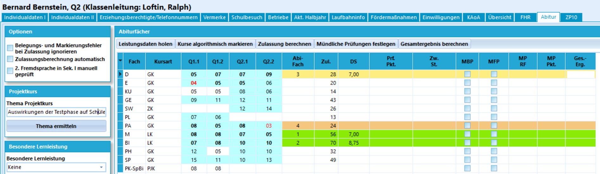

Das Abitur wird zum größten Teil über diesen Reiter verwaltet, der auch über *Gruppenprozesse* befüllt werden kann.

### Der Bereich Abiturfächer

Im Reiter Abitur sind die *Unterreiter* unter **Abiturfächer** zu beachten. Von links nach rechts bilden diese den Weg zum Abitur ab. 
* Zuerst werden die Leistungsdaten aus den Lernabschnitten geholt,
* dann werden die einzubringenden Kurse markiert. Mit einem `Doppelklick` können Sie Markierungen an- und abwählen. Der Algorithmus ist grundsätzlich sehr fähig, die für die Schülerinnen und Schüler beste Kombination zu finden, dennoch müssen Sie alle Wahlen persönlich kontrolliert sein.
* Anschließend wird die Zulassung berechnet. Das Kürzel der Spalte **Zul.** ist die gewichtete Punktsumme, hier im Beispiel GKs einfach und LKs doppelt und die Spalte **DS** ist der Durchschnitt in *Punkten*.
* die Prüfungsergebnisse eingetragen, diese finden sich in der Spalte **Prf. Pkt**, wieder in Punkten. UNter **Zw. St.** finden Sie die *Zwischenstand* in gewichtiten Abiturpunkten.
* Es schließen sich die *Mündlichen Prüfungen* an, die als *Bestehensprüfungen* (**MBP**) oder freiwillig **MFP** angesetzt werden. Die Schülerinnen und Schüler, die in diese Prüfungen gehen, sollten über mögliche Ergebnisse - jeweils die Verbesserungen oder auch möglichlichen Verschlechterungen durch Prüfungsergenisse - beraten werden. Sie legen nun eine möglichst sinnvolle Reihenfolge für die mündlichen Prüfungen fest (**MP RF**), die den größten Erfolg mit den wenigsten Prüfungen verspricht. In der Spalte **MP Pkt.** werden dann die Ergebnisse eingetragen.
* Am Ende findet sich unter **Ges. Erg.** das *Gesamtergebnis*.

::: tip Achten Sie auf Aktualität der Leistungsdaten
Beachten Sie, dass der Reiter Abitur nur aktualisiert wird, wenn Sie die **Leistungsdaten holen**. Werden also in der Zwischenzeit noch einmal Ergebnisse in den Leistungsdaten verändert, wird der Reiter *nicht* automatisch aktualisiert. 
:::

:: tip Das Holen von Leistungsdaten überschreibt alle Änderungen
Wenn Sie auf **Leistungsdaten holen** klicken, werden *alle* Änderungen und Eintragungen im Reiter Abitur überschrieben. Damit wären schon eingetragene Prüfungsergebnisse gelöscht. Diese Löschung wird auch vorgenommen, wenn Sie die Daten per *Gruppenprozess* aktualisiert werden. Achten Sie also unbedingt darauf, dass *erst* alle Leistungsdaten von allen Schülern aktuell sind - und dass dann *niemand im Oberstufen-Team* mehr die Leistungsdaten in den Reiter Abitur holen möchte.

Immerhin wird noch eine Warnung generiert, die mit *"OK"* zu bestätigen ist. Klicken Sie auf `Zulassung berechnen`, nachdem Prüfungsergebnisse eingetragen sind, werden diese *ohne Warnung* gelöscht!

Passiert das doch jemandem, ist die Strafe mindstens eine Tüte Gummibärchen!
::: 

### Der linke Bereich

Auf der linken Seite werden unter **Option** zwei Möglichkeiten angeboten, die automatische Prüfungen zu ignorieren.

Unter **Belegungs- und Zulassungsfehler ignorieren** können Sie eine Zulassung manuell erzeugen, so dass auch für jemand mit Fehlern bei die Berechnung von Prüfungsergebnissen und die Gesamtprüfung durchgeführt werden kann.

Ein Anwendungsfall könnte ein mit der Schulaufsicht abgesprochener Einzelfall sein. In diesem Falle wird SchILD-NRW 3 sich einer Dezernenten-Entscheidung nicht entgegen stellen.

Ein andere Fall könnte sein, dass ein technischer Fehler in den Algorithmen nicht die Bearbeitungs des Abiturs mit SchILD-NRW 3 verhindert oder zumindest verzögert.

Mit dem Haken bei **2. Fremdsprache in Sek. I manuell geprüft** können Sie einen Fehler mit der 2. Fremdsprache ignorieren. Dies konnte "früher" vorkommen, wenn ein Fach falsch konfiguriert war. Mit dem SVWS-Server sollte sich dieser Fall aber nicht mehr stellen. Für Einzelfälle, in denen es doch aus welchen Gründen auch immer zu Problemen kommt, lässt sich mit diesem Schalter jedoch ein Blockade durch SchILD umgehen.

Der Schalter **Zulassungsberechnung automatisch** führt bei jedem Holen der Leistungsdaten direkt eine *automatische algorithmische Markierung der Kurse* und die *Zulassungsberechnung* aus. Ob die Funktion sinnvoll ist oder nicht, ist debattierbar. Die hier besprochenen Prozesse werden im Regelfall per Gruppenprozess über den ganzen Jahrgang durchgeführt (siehe weiter unten) und daher ist die Verarbeitung individuell im Reiter nur für Einzelfälle relevant.

Diese Aussage gilt auch für den Bereich **Projektkurs**, die Schaltfläche `Thema ermitteln` holt sich das Projektkursthema aus den *Fachbezogenen Bemerkungen* in den *Leistungsdaten des Faches* der Projektkurs-Halbjahre und wird im Standardfall für alle Schülerinnen und Schüler per *Gruppenprozess* angestoßen.

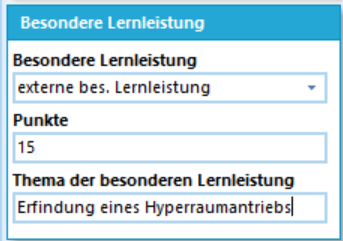

Wird eine *Besondere Lernleistung* anerkannt, wird dies ebenfalls hier links vorgenommen. Tragen Sie einen Wert für die **Punkte**  und das *Thema* ein und wählen Sie aus dem Dropdownmenü eine Besondere Lernleistung. Per Standard steht der Wert hier auf *keine* und Eingabefelder sind ausgeblendet. Es stehen (aktuell) folgende Arten zur Wahl:
* externe bes. Lernleisung
* Projektkurs ist bes. Lernleistung

Wählen Sie, was nach der APO GOSt zulässig ist.

Unter **Weitere Angaben** ist das **Abiturjahr** und der betreffende Lernabschnitt zu setzen. Das ist ein Feld, das automatisch gesetzt ist und zur Sicherheit einmal per Gruppenprozess zu generieren ist.

### Die Auswertung

In der Fußzeile finden Sie die **Auswertung**, die Stück für Stück von *Block I* über *Block II* hin zum *Abitur* befüllt. Diese Zusammenfassungen sind es, die in den Zentralen Abiturausschüssen zu behandeln sind.

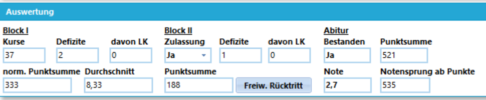

Der *Block I* setzt sich aus den Leistungsdaten der Halbjahre aus der Q-Phase zusammen und führt die *eingebrachten Kurse* in ihrer vorgesehenen Gewichtung auf. Sie sehen unten links die bislang erreichte Abitur-Punktsumme und schließlich das Ergebnis **Zulassung** unter *Block II*. Hier kann auch manuell eine Einstellung vorgenommen werden.

Kommt es zu einem **Freiwilligen Rücktritt** von der Abiturprüfung, klicken Sie auf die entsprechend benannte Schaltfläche.

Zu diesen Zeitpunkt sind die folgenden Felder noch leer.

Erst, wenn Sie die **Prüfungsergebnisse** eingetragen haben, werden diese mit den **Defiziten** und der weiteren **Abitur-Punktsumme** befüllt.

Wurde das Abitur nun schon bestanden, wird das Feld **Abitur Bestanden** mit der Berechnung des Gesamtergebnisses auf *Ja* gesetzt. Ist das Abitur noch nicht bestanden, sind die **Bestehensprüfungen** durchzuführen, dann klicken Sie jeweils auf `Gesamtergebnis berechnen` und erhalten den aktuellen Stand, ob bestanden wurde oder (noch?) nicht und wo die Punktsumme steht.

Zum Abschluss wird die Abiturnote unter **Note** hinterlegt und für weitere Beratungen, etwa, ob freiwillige Prüfungen empfehlenswert sind, wird angezeigt, ab welcher Abitur-Punktzahl ein Notensprung anstehen würde (**Notensprung ab Punkte**).

::: tip **Zulassung berechnen** löscht alle Prüfungsergebnisse
Wie schon oben geschrieben: das Holen von Leistungsdaten löscht an dieser Stelle die Prüfungsergebnisse mit Warnung, das erneute Berechnen der Zulassung tut dies ohne Warnung.
:::

## Reports

Rund um das Abitur werden unterschiedliche über SchILD-NRW 3 zu generierende Reports genutzt.

Sie finden in der **Basisreportsammmlung** Reports zur *Sek II* für das Abitur. Nutzen Sie einen Report, der kursweise einen *Mantelbogen in A3* generiert, der bei der *verbindlichen Festlegung der Abiturfächer* verwendet werden kann oder in denen die Ergebnisse des *Blocks I* und des *Blocks I und II* für den ersten (Zulassung) beziehungsweise zweiten ZAA (Prüfungsergebnisse) zusammengefasst werden. Ebenso finden Sie dort eine Schülerliste mit den *Abiturergebnissen*.

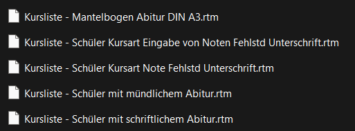

Weiterhin finden sich die *offiziellen Reports* für unterschiedeliche Phasen des Abiturs bei den **Abiturzeugnissen**. Hierbei handelt es sich um die für den jeweils zutreffenden Fall zu verwendenden **Anlagen**.

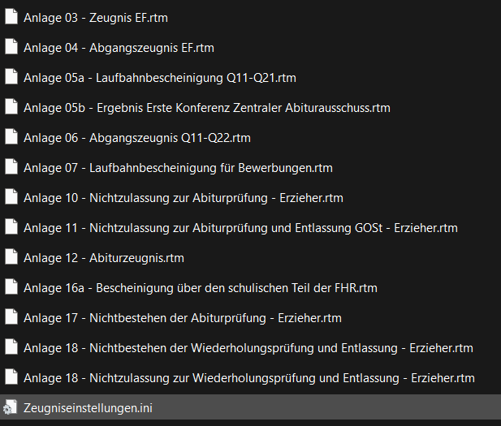

Nachdem Sie das Zeugnispaket zur Sekundarstufe entpackt haben, finden Sie dort alle zu verwendenden Anlagen. Diese reichen vom EF-Zeugnis über die Benachrichtungen zur Nichtzulassung bis zum Abitur.

Nutzen Sie die *Zeugniseinstellungen.ini*, um das Erscheinungsbild und die Datenquellen für zum Beispiel Datumsangaben der Anlangen bei Wunsch zu konfigurieren.

Viele der Einstellungen können im Standard übernommen werden.

Mitunter erhalten Sie über andere Schulen oder das Forum weitere Reports, die Sie verwenden möchten.

## Download schriftliches Abitur und FPA mündliches Abitur

Laden Sie die Abiturprüfungen nach den Vorgaben in den Anschreiben und Emails formal wie vorgesehen herunter.

Organisieren Sie die Fachprüfungsausschüsse, um das mündliche Abitur zu planen. Beachten Sie hier die Vorgaben für die Prüfenden und Fristen.

## Prüfungen

Die Ergebnisse der Abiturprüfungen werden laufend in SchILD-NRW 3 erfasst. Dies geschieht analog zur Zulassungsberechnung im Bereich **Schüler** und dort im Reiter **Abitur**.

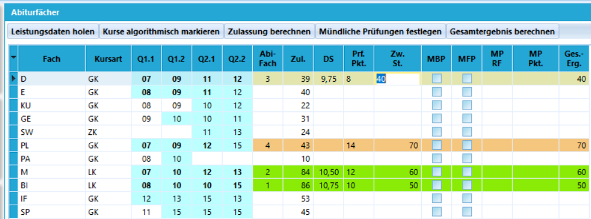

Nachdem die Prüfungsergebnisse eingetragen wurden, wird über *Gesamtergebnis berechnen* die Punktsumme für das Abitur gebildet, auch die Auswertung der Defizite wird vorgenommen.

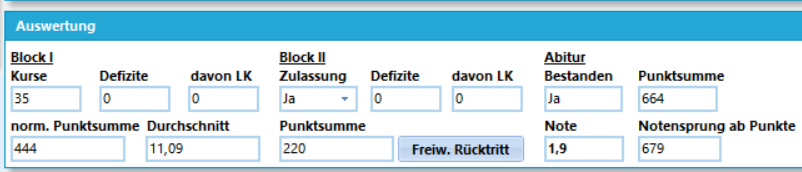

Im Fuß werden alle Prüfungen ausgewertet. In diesem Fall wurde das Abitur bestanden.

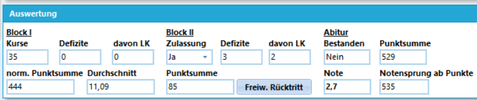

Im Beispiel oben reichen die Ergebnisse von den Punkte beziehungsweise den Defiziten nicht für ein Bestehen aus. Auch diese Zusammenfassung wird angezeigt.

### Weitere mündliche Prüfungen

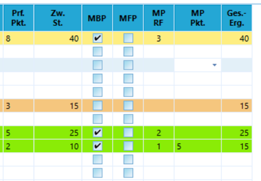

Bei Nichtbestehen des Abiturs werden *Mündliche Bestehensprüfungen (MBP)* per Haken angesetzt.

Im Beispiel wurde für die erste Prüfung schon die erreichte *Prüfungsnote (MP Pkt.)* eingetragen.

Zuerst sind händisch die *Reihenfolge (RF)* zu definieren. Hier werden die Prüfungen zuerst angesetzt, bei denen die Chance am besten erscheint, die notwendigen Punkte zu erreichen beziehungsweise Defizite aufzuwerten.

Hierbei kommt es immer auf den Einzelfall an.

::: tip Vorsicht für Verschlechterungen
Bedenken Sie aber bitte, dass Prüfungsergebnisse, die schlechter als die Ausgangsnote ausfallen, auch zu einer Verringerung der Abitur-Punktsumme führen können.

Beraten Sie taktisch sinnvoll.
:::

Wurde das Abitur schon nach der 1. oder 2. Bestehensprüfung bestanden, können weitere Prüfungen abgesagt und die MBP-Haken entfernt werden.

Sie sehen in der letzten Spalte *(Ges Erg.)* die jeweils erreichten Wertungspunkte.

Soll eine oder weitere *Freiwillige Mündliche Prüfung* angetreten werden, sind hier die Haken von Hand zu setzen und auch hier werden bei Bedarf Reihenfolgen eingegeben.

Beachten Sie gerade bei den freiwilligen Prüfungen den Hinweis oben zu möglichen Verschlechterungen des Abiturergebnisses.

## Nichtzulassung, Nichtbestehen und Rücktritt

Die Abiturlaufbahn kann im Prüfungsprozess an zwei Stellen beendet sein: 
* die Zulassung kann nicht erreicht werden
* die Abiturprüfung kann nicht mehr bestanden werden

Beim zweiten Punkt kann es vorkommen, dass zwar eine rechnerische Möglichkeit besteht, das Abitur doch noch über eine mündliche Prüfung zu bestehen, aufgrund der unrealistischen Perspektive entscheidet sich ein Prüfung nach einer Beratung jedoch, freiwillig von der Abiturprüfung zurückzutreten.

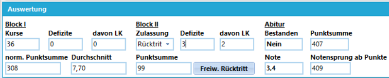

* Bei einer Nichtzulassung steht unter *"Zulassung"* am Ende des Blocks I ein **Nein**.
* Wird die Prüfung angetreten und schlussendlich nicht bestanden, steht am Ende von Block I unter Zulassung ein Ja und am Ende von Block II unter *"Abitur bestanden"* ein **Nein**.
* Tritt ein Prüfung von der Abiturprüfung zurück, klicken Sie auf die Schaltfläche `Freiw. Rücktritt` in der Abiturzusammenfassung im Fuß des Reiters Abitur. Damit bleibt *"Abitur bestanden"* auf **Nein** und unter **Zulassung** ändert sich der Inhalt auf **Rücktritt**.

Nun ist zu entscheiden, ob der Prüfling die Q2 wiederholen kann und möchte oder ob die Schullaufbahn an Ihrer Schule mit einem Angang beendet ist.

Für alle möglichen Fälle - keine Zulassung, Abitur nicht bestanden, Abgang, Abitur bestanden und so weiter - sind die passenden **Anlangen** aus dem Zeugnispaket über die *Zeugniseinstellungen.ini* zu konfigurieren und zu drucken.

Tragen Sie bei Abgängern unter **Schüler ➔ Schulbesuch** bei **Entlassung von eigener Schule** den bislang höchsten erreichten Abschluss im Feld **Art des Abschlussess** ein. Typischerweise wird dies ein *FHR* oder der *MSA-Q* sein. Beachten Sie hier die tatsächlich bislang erreichten Abschlüsse nach den durchlaufenen Prüfungsordnungen. 

## Gruppenprozesse

Haben Sie Schüler und Schülerinnen exklusiv aus der Q2 als Schülermenge ausgewählt, steht Ihnen ein neuer Bereich **Abitur** in den Gruppenprozessen zur Verfügung.

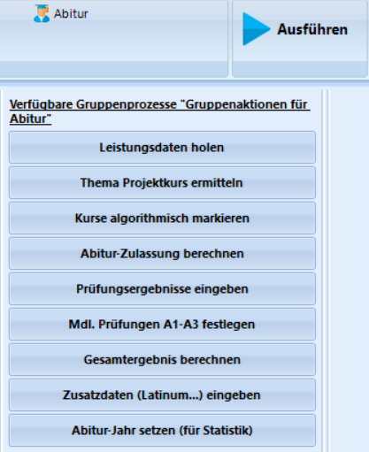

Die Schritte des Abiturprozesses, der in diesem Kapitel oben individuell behandelt wurde, lassen sich an vielen Stellen für den ganzen Jahrgang durchführen.

* Schreiben Sie im Anschluss an den Noteneintrag durch die Lehrkräfte die *Leistungsdaten* in den Reiter Abitur.
* Prüfen Sie, dass alle *Projektkursthemen* indivduell erfasst sind und holen Sie diese dann in den Reiter Abitur.
* Die Kurse sollten automatisch algorithmisch markiert sein, um sicher zu gehen, dass dies über den ganzen Jahrgang der Fall ist, können Sie den Gruppenprozess hier anstoßen.
* Nach der individuellen Kontrolle der Markierungen lassen Sie die *Zulassung berechnen*. Denken Sie hier daran, dass das Berechnen der Zulassung schon erzeugte Eintragungen im Reiter Abitur löscht! Sprechen Sie sich im Team ab, damit es nicht zu Missverständnissen kommt!
* Es schließen sich die drei Gruppenprozesse an, mit denen Sie nach und nach die *Prüfungsergebnisse eingeben* können.

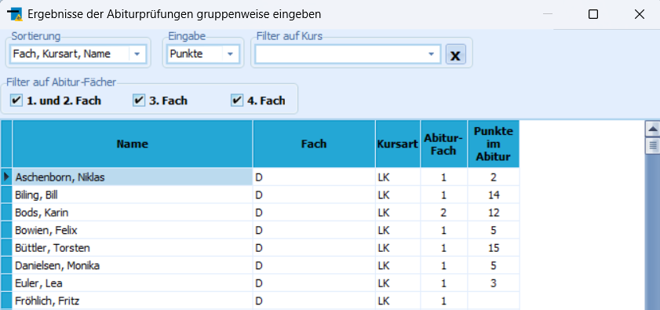

Beim Eintrag der Prüfungsergebnisse sind die Haken zum anzeigen der LKs und Abiturfächer wichtig. So kann man wählen, welche Prüfungsergebnisse gerade vorliegen und nur diese für den Eintrag anzeigen.

Liegen später weitere Ergebnisse von einem anderen Kurs vor, wählen Sie passenden Haken und filtern Sie auf den betreffenden Kurs, um dann diese Daten einzugeben.

Gegen Sie nichts ein, wird keine Note gelöscht. Geben Sie eine neue Note ein, wird die bisherige überschrieben.

Die Eintragungen werden mit einem Klick auf `In Datenbank übernehmen` gespeichert.

* Legen Sie Anschluss an die obligatorischen Abiturprüfungen die *mündlichen Bestehensprüfungen* fest.

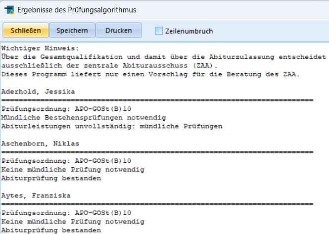

In diesem Prozess ist keine Einstellung vorzunehmen, am Ende wird einer Zusammenfassung für jeden Schüler oder Schülerin angezeigt. Kontrollieren Sie nun die Bestehensprüfungen individuell und legen Sie im Reiter Abitur eine Prüfungsreihenfolge fest.

*Freiwillige Mündliche Prüfungen* legen Sie immer individuell im Reiter Abitur an.

* Berechen Sie zum Ende des Abiturprozess das Gesamtergebnis für alle.
* Zusatzdaten wir ein erreichtes Latinum oder ähnlich können Sie zu einem beliebigen Zeitpunkt nach dem Ende der Noteneintragung setzen.
* Setzen Sie auch für alle Abiturienten das Statistikdatum des Abiturs. Dieser Schritt ist leicht zu vergessen und kann auch zu einem frühen Zeitpunkt erfolgen.  

## Zeugnisdruck Abitur

Konfigurieren Sie die Zeugniseinstellungen.ini für alle Anlagen. Es ist in vielen Fällen empfehlenswert, die Daten so zu wählen, dass möglichst viel aus der Datenbank geholt wird (Abschlussdatum, Zeugnisdatum und so weiter).

Drucken Sie die Zeugnisse so, wie es im Kapitel Zeugnisdruck beschrieben wurde.

Drucken Sie zuerst die Personen mit "Abitur", diese haben den Abschluss. Sofern Sie nicht über den Gruppenprozess *Zeugnisse drucken und Schüler ausschulen* drucken, müssen Sie erst über einen Gruppenprozess das Entlassdatum setzen und nach dem Zeugnisdruck den **Status** der Schüler und Schülerinnen auf **Abschluss**. Der Gruppenprozess erzeugt diese Eintragungen automatisch.

Gehen Sie analag mit den Abgängern vor, wählen Sie hier je nach Abgangszeitpunkt (Zulassung oder Nichtbestehen der Abiturprüfung) die korrekte Anlage. Den Status setzen Sie im Anschluss auf **Abgang**.


::: Zweitschriften archivieren
Denken Sie daran, die Zweitschriften von Abschluss- und Abgangszeugnissen zu archivieren. Papierkopien empfehlen sich, da diese auch in Jahrzehnten noch ohne unerwartete Probleme gelesen und kopiert werden können.
:::

Wollen Sie noch digitale Kopien als PDF-Datei in die Dokumentenablage oder ein über die Einstellungen von SchILD-NRW 3 gesetztes Zeugnisarchiv erzeugen, müssen Sie den Zeugnisdruck über die Reportverwaltung noch einmal wiederholen. Hierzu müssen Sie über **Auswahl** und dann im **Schülerfilter** erst in den **Individualdaten I** den aktuellen Lernabschnitt einstellen und den Jahrgang Q2 wählen. Sie bekommen Sie ihre Abschluss-Abiturienten und die Abgänger.

Müssen Sie in einem Fall noch nach der Abschlussart differenzieren, können Sie das zusätzlich über Reiter **Lernabschnitt/Leistungsdaten** definieren. 

Im Anschluss können Sie über die Reportverwaltung die Anlagen noch einmal "drucken".

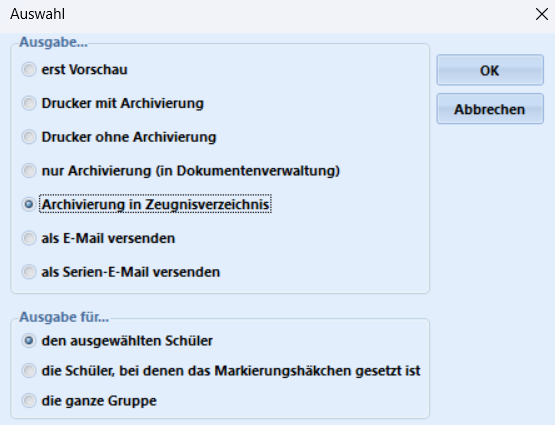

Je nach Filterung und wie Sie die Schüler oder Schülerinnen ausgewählt haben, können Sie wie immer nur die *ausgewählte Person*, eine *angehakte Gruppe* oder *die ganze Gruppe* verarbeiten lassen.

Sofern Sie nur in die Dokumentenablage drucken möchte, wählen Sie *nur Archivierung (in Dokumentenverwaltung)*. Soll in das Zeugnisarchiv gedruckt werden, wählen Sie *Archivierung in Zeugnisarchiv*.

::: tip Automatische Löschung des Dokumentenverzeichnisses
Beachten Sie hier, dass die automatische Datenlöschung von SchILD-NRW 3 die Dokumentenverwaltung eines Schülers nach einer Frist von 10 Jahren löscht (Stand 2026).
:::