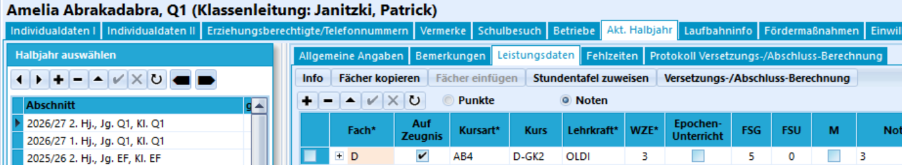
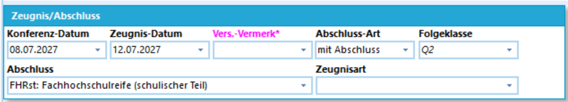
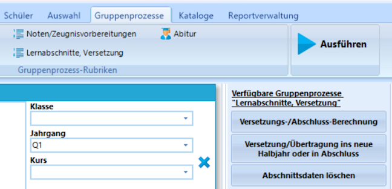
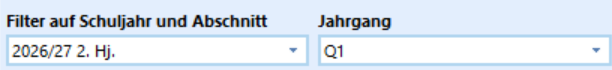
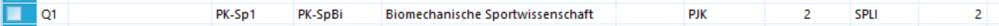
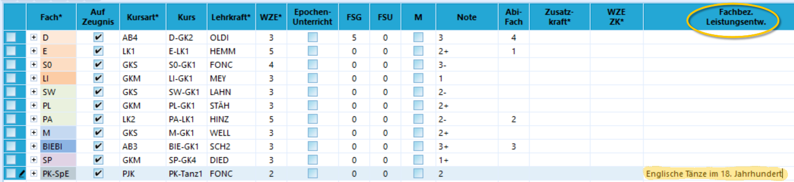
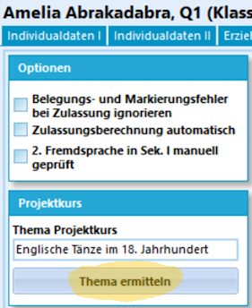

# Bemerkungen, Versetzungsberechnungen und Projektkurstitel

## Bemerkungen 

Sofern noch nicht beim Noteneinsammeln geschehen, können Sie im Anschluss Bemerkungen zum **Außerunterrichtlichen Engagement** setzen. Solche Bemerkungen können als **Floskel** im entsprechend benannten **Katalog** hinterlegt werden.

## Versetzungs- und Abschlussberechnungen

Die folgenden Arbeiten werden in SchILD-NRW 3 ausgeführt.

Zeugnisbemerkungen zu einer Versetzung und vergleichbar werden automatisch erzeugt, wenn Sie in SchILD-NRW 3 in **Schüler ➔ Akt. Halbjahr ➔ Leistungsdaten** die `Versetzungs- und Abschlussberechnung` anklicken.

Im Reiter *Protokoll zur Versetzungs- und Abschlussberechnung* finden Sie eine Zusammenfassung der Berechnungen. Diese sind im Falle einer nicht erreichten Versetzung oder, hauptsächlich ist dies in der Sekundarstufe I an Gesamtschulen interessant, für die diversen Abschlüsse am Ende der 10 in der SI aufschlussreich.

Sie finden das Ergebnis unterhalb der Leistungsdaten im Bereich **Zeugnis/Abschluss** und dann in den Feldern **Vers. Vermerk** und **Abschluss**.

Für die Oberstufe hihngegen ist relevant: es wird hier der **schulische Teil der Fachhochschulreife (FHR)** mit angezeigt, der ab dem 2. Halbjahr der Q1 erstmalig erreicht werden kann und ansonsten ausgewiesen wird, wenn die Leistungen in zwei aufeinanderfolgenden Halbjahren den Kriterien entsprechen.

::: tip Berechnung FHR und Abiturdaten
Die Berechnung des FHR und der Abiturdaten findet **nicht** über die Versetzungs- und Abschlussberechnung statt, sondern wird in den eigenen Reitern **FHR** beziehungsweise **Abitur** angestoßen.

Werden diese Reiter nicht bei **Schüler** angezeigt, müssen Sie im Schülercontainer *ausschließlich* auf Personen der Q-Phase gefiltert haben.
:::

An dieser Stelle können Sie auch ein gesetztes Datum für die **Zeugniskonferenz** und die **Zeugnisausgabe** einsehen beziehungsweise bemerken, dass diese Daten noch nicht zugewiesen wurden.

Diese Einträge können Sie auch manuell überschreiben.

Diese Berechnungen lassen sich über **Gruppenprozesse ➔ Lernabschnitte, Versetzung** und dann über einen Klick auf `Versetzungs-/Abschluss-Berechnung` für die Auswahl im ganzen Schülercontainer durchführen lassen.

Hierbei werden eventuell zuvor gemachte manuelle Änderungen wieder überschrieben.

## Projektkurse eintragen

Im **Katalog ➔ Kurse** können Sie auf die Kurse des passenden Jahrgangs filtern und dann als **Zeugnisbezeichnung** den Titel des Projektkurses vergeben.

Nachdem Sie auf einen Jahrgang in einem Lernabschnitt gefiltert haben, können Sie eine **Zeugnisbezeichnung** für einen Projektkurs vergeben. Dieser Kurs ist häufig ein vorherigen Lernabschnitt, wenn Sie etwa zum Abitur auf die damalige Q1 filtern.

Achten Sie darauf, dass die Zeugnisbezeichnungen in das vorgesehene Feld auf Ihren Formularen passen.

### Thema der Projektkursarbeit

Das auf Leistungsübersichten ausgegebene **Thema des Projektkurses** setzen Sie individuell bei jedem Schüler und jeder Schülerin. Sie können das Thema dieser **Projektkursarbeit** nicht direkt im Reiter **Schüler ➔ Abitur** eintragen, sondern müssen den Umweg über die **Fachbezogenen Leistungsbemerkungen** gehen.

Gehen Sie über **Verwaltung ➔ Einstellungen ➔ Globale Einstellungen** und dort zur **Ansicht**. Setzen Sie den Haken bei *Fachbezogenes Bemerkungsfeld zeigen*.

::: tip Hohe SchILD-Rechte benötigt
Für die globalen Einstellungen werden hohe SchILD-Rechte benötigt. Wenn Sie diese Einstellungen nicht vornehmen können, bitten Sie Ihre SchILD-Administration, diese Einstellung zu setzen.

An dieser Stelle können Sie auch aktivieren, dass in SchILD-NRW 3 eine Spalte für *Quartalsnoten* bei den Leistungsdaten mit angezeigt wird.
:::

Nachdem diese Einstellung vorgenommen wurde, steht bei den Schülerinnen eine weitere Spalte in den *Leistungsdaten des Aktuellen Halbjahres* zur Verfügung:

Mit einem Doppelklick in der korrekten Spalte und Zeile - *Fachbez. Leistungsentw.* und der *Projektkurs* lässt sich ein freier Text eingeben. 

Gehen Sie anschließend auf den Reiter **Schüler ➔ Abitur** und klicken Sie auf `Thema ermitteln`, um das Thema aus den Fachbezogenen Bemerkungen in den Reiter Abitur zu holen:

Anschließend ist das Thema für eine Ausgabe auf *Leistungsübersichten Q1.1 bis Q2.1* und dem *Abiturzeugnis* eingetragen.

## Teilleistungen

Sofern Sie in der gymnasialen Oberstufe Teilleistungen erfassen möchten, konsultieren Sie die Artikel in der Dokumentaiton zum SVWS-Client und in der SchILD-NRW-3-Dokumentation zu diesen.

Mit Teilleistungen können Sie zum Beispiel SoMi-Noten oder die Ergebnisse von Klausuren in Ihrer Datenbank erfassen und über Reports ausgeben. Hierbei fällt auch ein Mehraufwand für die Einrichtung und das Einsammeln an.

---

Befinden Sie sich in der Q-Phase, prüfen Sie, ob der schulische Teil der Fachhochschulreife erreicht wurde.

An diese Arbeitsprozesse folgt im Anschluss das Erzeugen von Leistungsübersichten zur Beratung und für eine Konferenz. Sie können Konferenzen ebenfalls mit dem SVWS-Konferenzmodul durchführen.