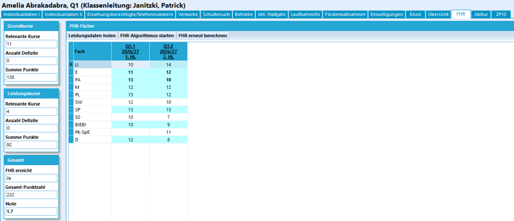
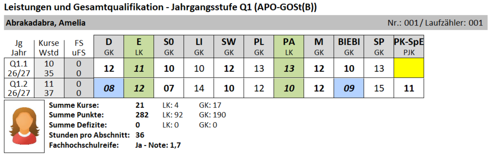

# Die Fachhochschulreife

Ab dem zweiten Halbjahr der Q-Phase ist auf das Erreichen eines FHR zu prüfen. Hierfür gibt es in SchILD-NRW 3 den Reiter **FHR**.

Sie müssen im Auswahlcontainer exklusiv Schüler der Q-Phase ausgewählt haben, damit dieser Reiter erscheint.

Anschließend können Sie auf `Leistungsdaten holen` klicken, um die aktuell eingetragenen Fächer und Noten in den Reiter zu holen.

::: tip Aktualität!
Hierbei ist zu beachten, dass der Reiter nicht automatisch auf den neuesten Stand gebracht wird, sollten bei den Leistungsdaten in der Lernabschnitten etwas verändert werden. Sie müssen immer die Leistungsdaten neu holen!
:::

Klicken Sie anschließend auf `FHR-Algorithmus starten`, um auf einen FHR zu prüfen und bei Bestehen die **Gesamtpunktzahl** mit der zugehörigen **Note** zu berechnen.

Sie bekommen links in den Kästen eine detailliertere Übersicht.

 (Zusammenfassung)

Wurde dieser Prozess ausgeführt, kann *FHR bestanden: Ja/Nein* mit einer zugehörigen Note in den relevanten Reports - inklusive der Zeugnisse - ausgegeben werden.

## Berechnung per Gruppenprozess

