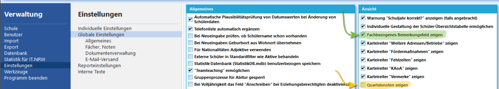
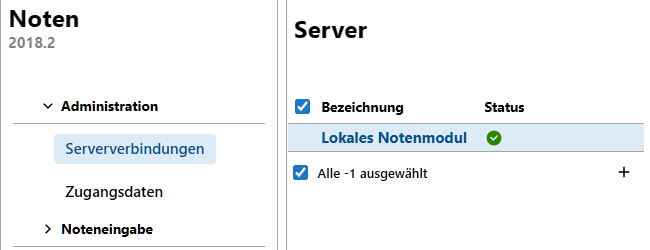
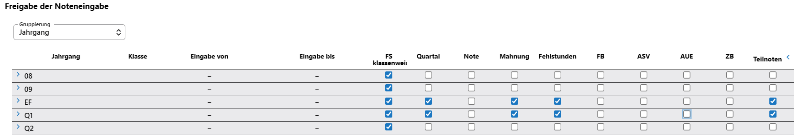
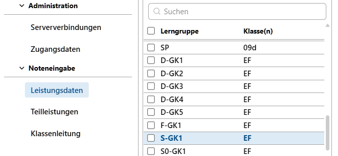
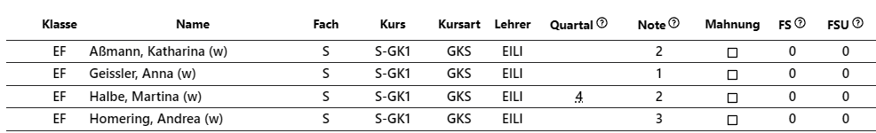
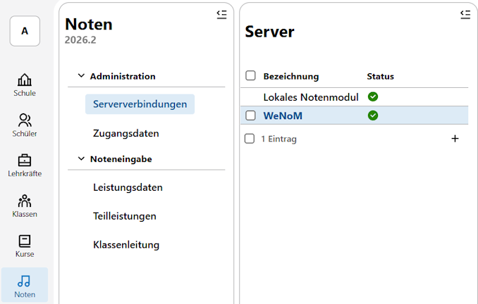
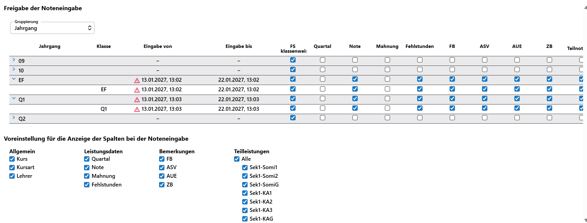
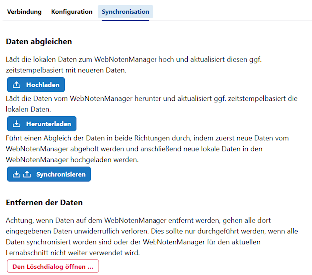
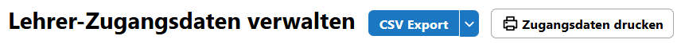

# Leistungsdaten einholen

Bei den **Leistungsdaten** von Schülern und Schülerinnen handelt es sich um die in einem Lernaschnitt zugeordneten Fächer mit ihren Kuresen und den jeweiligen Lehrkräften.

Vollständig sind die Leistungsdaten, wenn auch die **Noten**, **Fehlstunden** und weitere Bemerkungen eingetragen werden.

* Diese Daten können für jede Person individuell in den SVWS-Client oder in SchILD-NRW 3 eingetragen werden.
* Weiterhin können Sie Gruppenprozesse in diesen Programmen, zum Beispiel zum Eintragen von Daten "kursweise" verwenden.
* Mit dem SVWS-WebNotenManager (WeNoM) steht ein hilfreiches Werkzeug zur Verfügung, mit dem Noten durch Lehrkräfte von einem beliebigen Ort eingetragen werden können.

::: tip Kontrollieren Sie den Datenbestand
Bevor der Notenprozess beginnt, ist es empfehlenswert, den Datenbestand auf Aktualität zu kontrollieren. Mitunter wechseln Schüler einen Kurs oder es wurden zu Schuljahresbeginn noch Fehler in der Kurszuweisung korrigiert. Ebenso kann es vorkommen, dass Lehrkraft-Wechseln vorgenommen werden mussten. Ist der Datenbestand hier nicht aktuell, werden mitunter Kurse an die falschen Lehrkräfte in den Notenmodulen ausgegeben und ein korrekter Noteneintrag ist somit nicht möglich. Auch die Kursart - GKM, GKS - oder die mitunter um-gewählten Abiturfächer sollten auf Korrektheit geprüft werden.
:::

::: tip Wie viel Zeit benötigen Sie?
Überlegen Sie an dieser Stelle, wieviel Zeit Sie benötigen, um die eingetragenen Noten zu Konferenzen oder Zulassungen zu verarbeiten oder fehlende Noten noch individuell einzufordern. Reichen Ihnen zwei Werktage oder sollen es besser vier sein? Es ist überlegenswert, den Zeitraum der Noteneintragung lieber um einen Werktag zu verkürzen und dafür diesen Werktag selbst länger Zeit zu haben.
:::

::: tip Welche anderen Daten sollen aufgenommen werden?
Stellen Sie ebenfalls sicher, dass die gewünschten **Bemerkungen** im gewünschten Zeitraum eingetragen werden. Wer trägt eventuelles **Außerunterrichtliches Engagement** ein? Woher kommt die Information, wer sihc in der Schülervertretung engagiert hat? Welche weiteren Informationen möchten Sie auf Zeugnissen ausgeben und wer ist in der Schule dafür verantwortlich, die notwendigen Daten rechzeitig einzuholen und anschließend in SchILD-NRW, SVWS-WeNoM oder im SVWS-Client einzutragen?

Achten Sie darauf, dass Sie für alle diese Aspekte *Floskeln* definieren können, die ebenfalls an den SVWS-WeNoM zur Verwendung übertragen werden.
:::

Entscheiden Sie zuerst, wie **Fehlstunden** erfasst werden sollen. Sie können **Fehlstunden in der Sek II** als Gesamtsumme erfassen. Diese erscheinen dann unter **Schüler ➔ Akt. Halbjahr ➔ Allgemeine Angaben** oder, falls Sie **Fehlstunden fachbezogen** erfassen, jeweils in der Zeile für jeden Kurs.

Möchten Sie **Quartalsnoten** mit bei den Leistungsdaten der Schüler und Schülerinnen anzeigen und erfassen, muss diese Spalte in den **Globalen Einstellungen** aktiviert werden.

Unter **Verwaltung ➔ Einstellungen ➔ Globale Einstellungen** können Sie im Bereich **Ansicht** Quartalsnoten in SchILD-NRW 3 bei den Schüler-Leistungsdaten aktivieren. Um Projektkursthemen einzugeben werden das **Fachbezogene Bemerkungsfeld** benötigt.

::: tip Höhere Rechte
Eventuell reichen Ihre Benutzerrechte nicht aus, in SchILD-NRW 3 globale Einstellungen zu verändern. Bitten Sie in diesem Falle Ihre SchILD-Administration, diese Einstellungen einmalig zu aktivieren.
:::

::: tip Die automatischen Berechnungen sind als Hilfestellung zu verstehen
Alle Berechnungen in SchILD-NRW 3 und dem SVWS-Client für Abschlüsse, Versetzungen, Zulassungen, Erreichen des FHR und so weiter sind als Hilfestellungen zu verstehen. Die Verantwortung für die Korrektheit der Ergebnisse liegt immer bei den zuständigen Personen.
:::

## Eintragungen über den SVWS-Client

### Eintragen individueller Noten

Nutzen Sie im SVWS-Client in der **App Schüler** im **Tab Lernabschnitte** die Spalten *Quartalsnote* und *Note*, um direkt die Noten aufzunehmen.

Über die **App Noten** können Sie die gleiche Oberfläche wie im SVWS-WebNotenManager verwenden, indem Sie unter **Serververbindungen** das **Lokale Notenmodul** konfigurieren.

Das *lokale Notenmodul* läuft ohne weitere Konfiguration direkt im SVWS-Client.

Hier im Screenshot wurde bei der **Gruppierung** nach *Jahrgang* gruppiert. Der Vorteil ist, dass damit alle S1-Klassen ausgeblendet werden und nur noch die Jahrgänge stehenbleiben. Dann wurde das Noteneinsammeln der Quartalsnoten für EF und Q1 ausgewählt, andere Daten wie etwa "Zeugnisbemerkugen" sind zum Quartal an dieser Stelle uninteressant und sollen gar nicht zum Schreiben angeboten werden. "Teilleistungen" sollen erfasst werden.

Nutzen Sie die ausführliche Erläuterung der App Noten hier in der Dokumentation für weitere Informationen. 

Anschließend können Sie über **Noteneingabe** die gewünschten **Leistungsdaten** ein, indem Sie einen Kurs anwählen.

Sie können hier nun die Leistungsdaten eintragen, die zuvor konfiguriert wurden. Hier im Beispiel sind das die Quartalsnoten und Mahnungen.

*Mahnungen* sind in der Oberstufe so nicht vorgesehen, aber die Oberstufenkoordination hat sich hier im Beispiel entschieden, sie im Zuge von Beratungsprozessen doch zu ermöglichen.

Weiterhin ist freigeschaltet, dass auch **Teilleistungen** eingegeben werden können. Dies können in der GOSt zum Beispiel SoMi-Noten oder Klausurnoten sein (zum Beispiel SM1, SM2, K1, K2, K2, ...).

Diese Einstellungen gelten als Beispiel für die Orientierung.

Die genaue Verwendung der Notenmodule finden Sie in die Artikeln der **App Noten** und in den Artikeln zum **SVWS-WebNotenManager**.

## Erfassen der Noten über SVWS-WeNoM

Die Installation und Konfiguration von SVWS-WeNoM, damit Sie es benutzen können, ist nicht Teil Ihrer Aufgaben. Dies ist Aufgabe der Schulträger-IT zusammen mit der schulischen Seite der Schulverwaltungs-Administration.

Wenn Sie den WebNotenManager installieren und verwalten möchten oder müssen, nutzen Sie bitte die Supportangebote, indem Sie das Forum verwenden oder Ihre Fachberatung kontaktieren.

### Stellen Sie die Jahrgänge ein

Ihre Aufgabe als Oberstufen-Koordination beginnt beim Einstellen Ihrer Jahrgänge bzüglich der konkreten Daten, die eingetragen werden sollen.

Gehen Sie über die **App Noten** und wählen Sie dort Ihrern WebNotenManager aus. Der gewählte Name wird von Schule zu Schule abweichen. Sie werden aber immer das oben behandelte *Lokale Notenmodul* sehen, mit dem Sie im SVWS-Client Daten eintragen können. Hier möchten Sie aber den *SVWS-WebNotenManager* anwählen.

Die übrigen Einstellungen sind genauso wie im oben ausgeführen *Lokalen Notenmodul*.

Hier im Beispiel wurden die EF und Q1 für die Noteneingabe geöffnet. Weiterhin wurden ein **Startdatum** und ein **Enddatum** für den Noteneintrag gesetzt. Bis auf die Quartalsnoten wurden alle möglichen Einträge und Spalten zur Ansicht und Eintragung geöffnet.

::: tip Teilleistungen
Bei den **Teilleistungen** unten rechts fällt auf, dass bislang keine Teilleistungen für die Sekundarstufe II definiert wurden. Zu Teilleistungen konsultieren Sie bitte die passenden Artikel in der Dokumenation zum SVWS-Client und SchILD-NRW 3. Wurden welche für die SII definiert, können diese hier mit zum Noteneintrag angewählt werden. 
:::

### Synchronisieren Sie die Daten zum Noteneintrag auf den SVWS-WeNoM

::: tip Dienstliche Emailadressen müssen vorliegen
Stellen Sie sicher, dass jeder Lehrkraft eine **Dienstliche Emailadresse** zugeordnet ist. Eine Lehrkraft meldet sich über die Dienstliche Emailadresse als Benutzername und das eigene Kennwort beim WeNoM an.
:::

Nachdem Sie die Jahrgänge wie gewünscht eingestellt haben, müssen diese Daten von Ihrem SVWS-Server, der im Verwaltungsnetz läuft, auf den auf einem externen Server installierten SVWS-WebNotenManager übertragen werden.

Gehen Sie über den **Tab Synchronisation** klicken Sie auf `Hochladen`. Dabei werden die Initialkennworte der Lehrkräfte, die Lehrkraftzugänge und deren Kurse auf den WeNoM übertragen. Ebenso werden die Einstellungen, die Sie gerade vorgenommen werden, auf dem WeNoM eingerichtet.

Lassen Sie den Lehrkräften die Adresse des WeNoM-Servers und ihre Initialkennworte zukommen. Diese können aus dem SVWS-Client exportiert werden: gehen Sie in die **App Noten** im Bereich **Administration Zugangsdaten** und klicken Sie in der Kopfzeile auf den CSV-Export.

Diese Daten können Sie nun mit einem Tabellenkalkulationsprogramm wie MS Excel oder Open Office Calc zur Weitergabe aufbereiten.

Alternativ können die Daten hier direkt gedruckt werden, klicken Sie hierzu auf `Zugangsdaten drucken`. 

Die Lehrkräfte können nun ihre Daten eintragen.

Reichen Sie gegebenfalls die Handreichung aus dem WeNoM-Handbuch dieser Dokumentation weiter. Das WeNoM-Handbuch ist über die Kopfzeile hier verlinkt.

Um einen Zwischen- oder Endstand der Daten wieder zurück in Ihren SVWS-Server im Verwaltungsnetz zu spielen, klicken Sie auf `Herunterladen`. Hierbei werden die eingebenen Daten zurückgespielt.

An dieser Stelle lassen sich auch die unterschiedlichen **Bemerkungen** eintragen.

::: tip Die neuesten Einträge werden behalten
Wurden in der Zwischenzeit Daten im Verwaltungsnetz und auf dem WeNoM verändert, wird ein Zeitstempel verglichen und der neueste Eintrag wird übernommen.
:::

Sollen im Anschluss an den Noteneintrag alle Daten auf dem WebNotenManager entfernt werden, können Sie `Den Löschdialog öffnen...`. Bei diesem können Sie wählen, ob alle - Sek I wie Sek II - Daten des Lernabschnitts entfernt werden oder ob auch alle Benutzerdaten, also die Lehrkräfte, mit gelöscht werden.

::: tip Das Ende des Noteneintrags sollte eindeutig sein
Setzen Sie ein Enddatum für den Noteneintrag oder entfernen Sie die Möglichkeit zum Noteneintrag zum Ende des vorgesehenen Zeitraumes, damit "verspätete" Noten nicht noch nach der letzen Synchornisierung nachgetragen werden und unberücksichtigt bleiben.
:::

## Eintragen über SchILD-NRW 3

SchILD-NRW 3 bietet viele nützliche Funktionen zum Ein- und Nachtragen von Noten und Fehlstunden. Ebenso werden das **Konferenz- und Zeugnisdatum** über SchILD-NRW-3 per Gruppenprozess bei den Schülerinnen und Schülern eingetragen.

Auch Ausschulungen von Abgängern und Abschlüssen lassen sich mit SchILD vornehmen.

Konsultieren Sie hierzu den folgenden Artikel und die Artikel in der Dokumentation zu SchILD-NRW 3.

---

Sofern Sie die Noten eingesammelt und eingetragen haben, fahren Sie mit dem Artikel zu Bemerkungen und Projektkursen fort.
