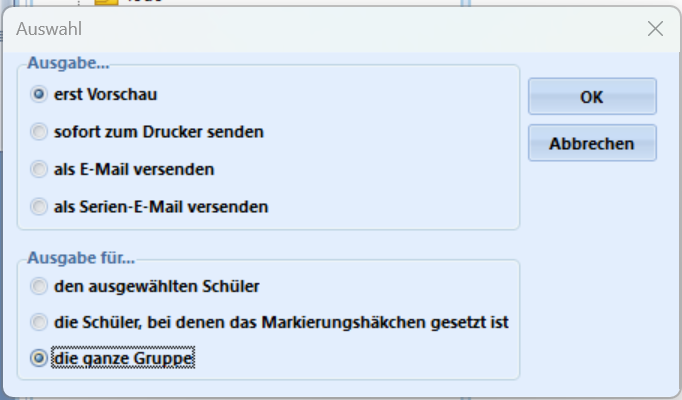
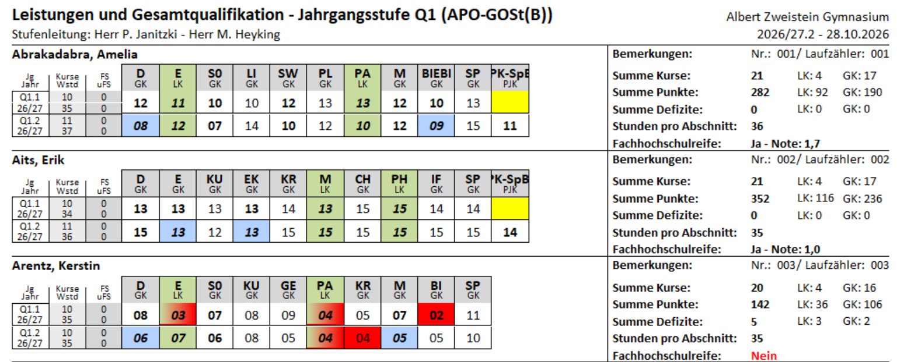

# Erzeugen von Leistungsübersichten und Konferenzvorlagen

Ausgangspunkt für Leistungsübersichten und Konferenzvorlagen ist die **Reportverwaltung in SchILD-NRW 3**.

Bei der Installation von SchILD-NRW 3 wird die *Basisreportsammlung* direkt mit installiert.

Wählen Sie in SchILD-NRW 3 erst die Schülergruppe aus, für die Sie eine Leistungsübersicht erzeugen möchten.

Öffnen Sie dann die Reportverwaltung:

Wählen Sie das Verzeichnis Ihrer *Basisreportsammlung* an.

::: tip Aktualisierte Basisreportsammlung
Die Basisreportsammlung wird weiterhin aktualisiert. Es kann sich lohnen, über die Seite des MSB für Schulverwaltungssoftware eine aktuelle Version herunterzuladen. Bei einem späteren Update von SchILD-NRW 3 wird eine existierende Basisreportsammlung nicht automatisch überschrieben.

Nutzen Sie die Anleitung in der SchILD-NRW-3-Dokumentation zur Installation der Basisreportsammlung.
:::

Hier im Beispiel wurde die *Q1* ausgewählt. Im Screenshots sind drei Leistungsübersichten für die Q-Phase zu sehen:
* die erste ist für die Beamerprojektion optimiert.
* die zweite ist für einen Listendruck oder die Verteilung als pdf vorgesehen.
* in der dritten Leistungsüberscht sind ebenfalls *Teilleistungen* enthalten.

Doppelklicken Sie auf den gewünschten Report. Stellen Sie sicher, dass im Auswahlmenü `die ganze Gruppe` oder die ausgewählten Schüler angewählt sind, wenn die Liste für mehr als die eine aktiv angewählte Person erzeugt werden soll.

Entscheiden Sie, ob Ihre Liste erst einmal als *Vorschau* erzeugt werden soll oder ob Sie diese *sofort zum Drucker senden* möchten. 

::: tip PDF erzeugen
In MS Windows steht ein Standarddrucker zur Verfügung, mit dem Sie einen Report als "PDF drucken" können, um ein digitales Dokument zu erzeugen.
::: 

Im folgenden Screenshot wurde der Report *Klassenliste - Leistungsübersicht Jg. Q1 bis Q2 Beamerprojektion @KL.rtm* erzeugt. Hierbei wird jeweils eine Person auf einer A4-Seite quer mit Farbe und großer Schrift dargestellt. 

Noch was

Eigene Reports (Forum)