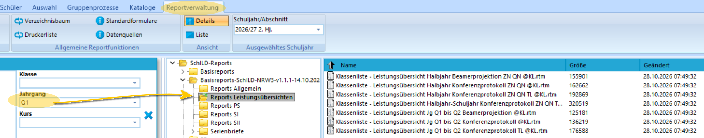

# Erzeugen von Leistungsübersichten und Konferenzvorlagen

## Listen und pdf-Dateien

Ausgangspunkt für Leistungsübersichten und Konferenzvorlagen ist die **Reportverwaltung in SchILD-NRW 3**.

Bei der Installation von SchILD-NRW 3 wird die *Basisreportsammlung* direkt mit installiert.

Wählen Sie in SchILD-NRW 3 erst die Schülergruppe aus, für die Sie eine Leistungsübersicht erzeugen möchten.

::: tip Kontrollieren Sie, ob alle Daten vorliegen und berechnet wurden
Vor der Konferenz sollte noch einmal geprüft werden, ob alle Daten wie Konferenzdatum und Zeugnisdatum für alle Schülerinnen eingetragen wurden. Ebenso müssen Noten oder Fehlstunden vollständig eingetragen sein. Automatische Berechnungen, etwa das Aussummieren fachbezogen eingetragener Fehlstunden muss angestoßen worden sein oder die Prüfungen auf das Erreichen des FHR sind zuvor auszuführen.
:::

Öffnen Sie dann die Reportverwaltung:

Wählen Sie das Verzeichnis Ihrer *Basisreportsammlung* an.

::: tip Aktualisierte Basisreportsammlung
Die Basisreportsammlung wird weiterhin aktualisiert. Es kann sich lohnen, über die Seite des MSB für Schulverwaltungssoftware eine aktuelle Version herunterzuladen. Bei einem späteren Update von SchILD-NRW 3 wird eine existierende Basisreportsammlung nicht automatisch überschrieben.

Nutzen Sie die Anleitung in der SchILD-NRW-3-Dokumentation zur Installation der Basisreportsammlung.
:::

Hier im Beispiel wurde die *Q1* ausgewählt. Im Screenshots sind drei Leistungsübersichten für die Q-Phase zu sehen:
* die erste ist für die Beamerprojektion optimiert.
* die zweite ist für einen Listendruck oder die Verteilung als pdf vorgesehen.
* in der dritten Leistungsüberscht sind ebenfalls *Teilleistungen* enthalten.

Doppelklicken Sie auf den gewünschten Report. Stellen Sie sicher, dass im Auswahlmenü `die ganze Gruppe` oder die ausgewählten Schüler angewählt sind, wenn die Liste für mehr als die eine aktiv angewählte Person erzeugt werden soll.

Entscheiden Sie, ob Ihre Liste erst einmal als *Vorschau* erzeugt werden soll oder ob Sie diese *sofort zum Drucker senden* möchten. 

::: tip PDF erzeugen
In MS Windows steht ein Standarddrucker zur Verfügung, mit dem Sie einen Report als "PDF drucken" können, um ein digitales Dokument zu erzeugen.
::: 

Im folgenden Screenshot wurde der Report *Klassenliste - Leistungsübersicht Jg. Q1 bis Q2 Beamerprojektion @KL.rtm* erzeugt. Hierbei wird jeweils eine Person auf einer A4-Seite quer mit Farbe und großer Schrift dargestellt. 

Für Notenlisten oder um mehr als nur einer Person gleichzeitig auf einer Konferenz darzustellen, wählen Sie zum Beispiel den Report *Klassenliste - Leistungsübersicht Halbjahr Konferenzprotokoll ZN QN @KL.rtm*. 

Hier wird die Version ohne Teilleistungen gezeigt.

::: tip Emailversand aus der Reportverwaltung
Bei den Standardreports bedeutet der Teil des Namens mit "@KL", dass diese Reports aus dem Reporting an die für den Jahrgang definierten "Klassenlehrkräfte", also die Jahrgangslehrkräfte, versandt werden können, sofern Ihr SchILD-NRW 3 für den Emailversand eingestellt ist.
:::

Nutzen Sie in vergleichbarer Weise eigene Reports oder Reports, die Sie über andere Quellen erhalten haben. Es kann sich lohnen, im Forum nach weiteren Reports zu fragen und in der Regel tauschen Oberstufenkoordinationen auch Reports untereinander.

Zum Beispiel könnten Sie einen Report verwenden, auf dem alle eine Klasse/einen Jahrgang unterrichteten Fachlehrkräfte aufgeführt sind, um eine Anwesenheitsliste auszulegen.

## SVWS-Client, SVWS-Konferenzmodul und SVWS-WeNoM