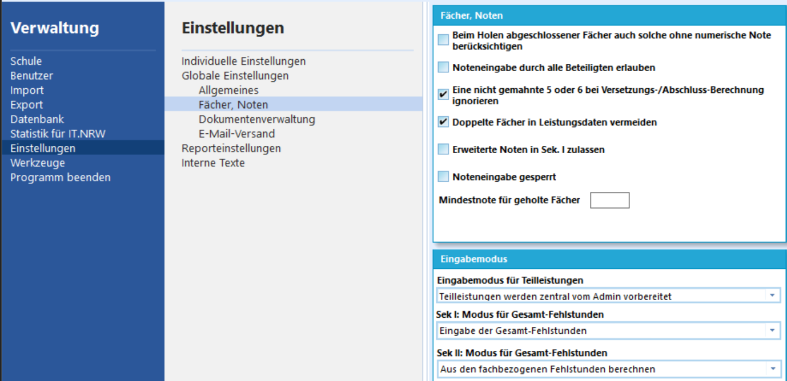
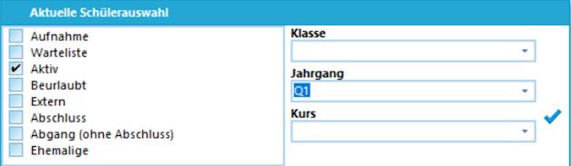
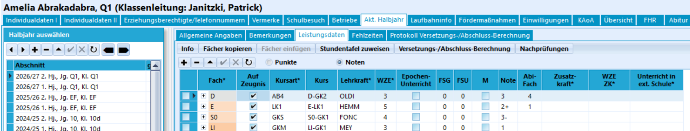
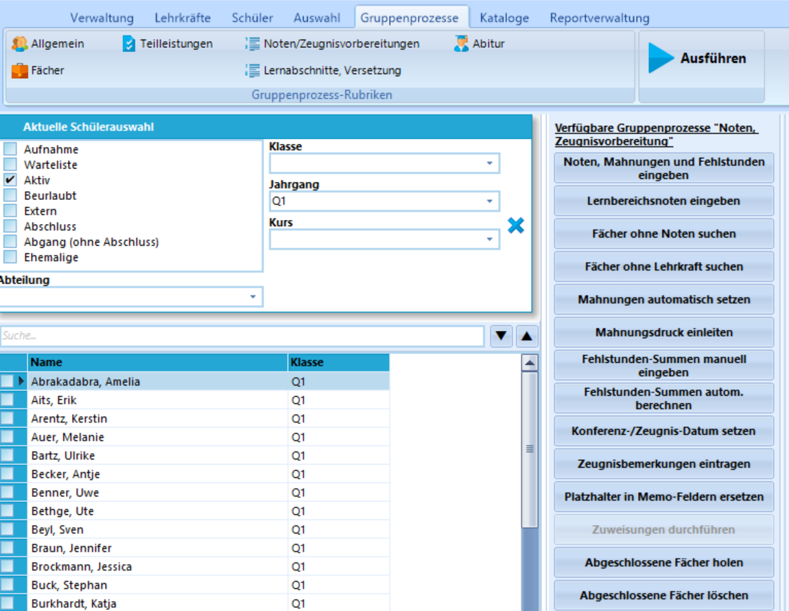
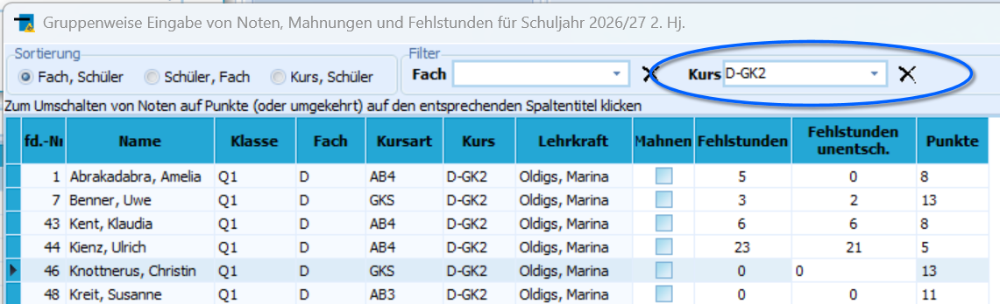
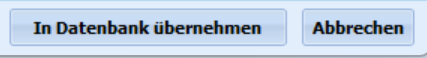
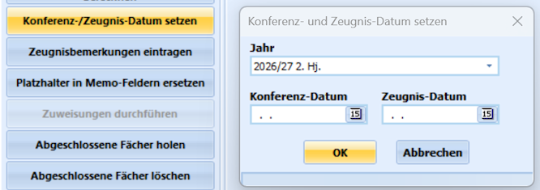

# Eintrag von Leistungsdaten über SchILD-NRW 3

:::tip SchILD-NRW 3-Dokumentation
Nehmen Sie bitte an dieser Stelle auch die ausführlichen Dokumentationen zu SchILD-NRW 3 zur Kenntnis, in der alle Aspekte des Noteneintrags ebenfalls beschrieben werden. In diesem Handbuch finden Sie eine Übersicht, um Daten effektiv einzutragen.
:::

Derzeit - Ende 2026 - bietet SchILD-NRW für die direkte Noteineintrung auch nützliche Funktionen für das Aufnehmen von Leistungsdaten. Der individuelle Noteneintrag im jeweiligen Lernbaschnitt ist im SVWS-Client vergleichbar und die Noten lassen sich ebenso kursweise über das lokale Notenmodul erfassen, je nach Fall lohnt sich auch ein Blick auf die Gruppenprozesse in SchILD-NRW 3.

Entscheiden Sie zuerst, wie **Fehlstunden** erfasst werden sollen. Sie können **Fehlstunden in der Sek II** als Gesamtsumme erfassen. Diese erscheinen dann unter **Schüler ➔ Akt. Halbjahr ➔ Allgemeine Angaben** oder, falls Sie **Fehlstunden fachbezogen** erfassen, jeweils in der Zeile für jeden Kurs.

Gehen Sie über **Verwaltung ➔ Einstellungen ➔ Fächer, Noten** und stellen Sie dort bei **Eingabemodus** ein, wie Fehlstundensummen in Ihrer Sek II erfasst werden sollen.

Hierbei ist zu beachten, dass Schulen mitunter externe (online) Schüler-Verwaltungssoftware oder digitiale Klassen- und Kursbücher verwenden, in denen Fehlstunden und Entschuldigungen erfasst werden und dann am Ende exportiert werden können. Ob Sie hier exportieren oder ob die Fachlehrkräfte die Summen selbst wieder in ein Notenprogramm eintragen, müssen Sie schulintern absprechen. Dann können Sie den Modus der Fehlstundenerfassung entscheiden.

::: tip Fehlstundensummen per Gruppenprozess bilden
Erfassen Sie **Fehlstunden fachbezogen** müssen Sie Ihre gewünschte Schülermenge auswählen und dann über **Gruppenprozesse ➔ Noten, Zeugnisvorbereitung** den Gruppenprozess **Fehlstundensummen autom. berechnen** ausführen. Die Fehlstunden werden somit in im oben erwähnten Reiter **Allgemeine Angaben** eingetragen.
:::

Hier im Beispiel wird die Q1 in SchILD-NRW 3 als Jahrgang ausgewählt. Wählen Sie Ihren Jahrgang und bestätigen Sie mit dem **Haken ✔**.

Nehmen Sie an dieser Stelle den Haken bei **Status** zur Kennntis, falls Sie **Externe Schüler** in Ihrer Datenbank mitverwalten. Eine Anwahl von Status **Aktiv** und Status **Extern** wählt auch die externen Schüler und Schülerinnen mit an.

Sie finden nun über die Reiter **Schüler ➔ Akt. Halbjahr ➔ Leistungsdaten** die *Lernaschnitte* und dann dort die Fächer/Kurse mit den Eintragungsmöglichkeiten für die **Noten**, **Fehlstunden** und **Unentschuldigten Fehlstunden**.

Je nach persönlicher Vorliebe könenn die **Noten** auch als **Punkte** dargestellt werden.

::: tip Abiturfächer
Ebenso können hier die **Abiturfächer** direkt eingetragen werden. Üblicherweise werden diese jedoch über die Laufbahnplanung im SVWS-Client mit verwaltet und dann bein Übertragen einer Blockung automatisch gesetzt und somit nicht mehr über SchILD-NRW 3 verwaltet. Technisch lassen sich die Abiturfächer aber nach wie vor in SchILD-NRW 3 verändern.
:::

## Eintrag über Gruppenprozesse

In der Praxis werden Noten oder Fehlstunden häufig nicht einzeln nachgetragen, sondern kursweise. Im folgenden Screenshot wurde die Jahrgangsstufe Q1 vorausgewählt, so dass die Gruppenprozesse über dieser Schülergruppe ausgeführt werden.

Im Bereich der **Noten/Zeugnisvorbereitungen** gibt es mehrere Gruppenprozesse, die für Sie interessant sein können:

### Noten, Mahnungen und Fehlstunden

Der Gruppenprozess **Noten, Mahnungen und Fehlstunden eingeben** ist ein effektiver Weg, um kursweise nachgelieferte Daten einzutragen. Dies kann notwendig sein, wenn eine Lehrkraft verspätet liefert oder es im Einzelfall technische oder personelle Probleme beim Erfassen der Noten gab.

Nach einem Klick auf den Gruppenprozess wählen Sie den **Lernabschnitt** aus, in dem Daten eingetragen werden sollen.

Sie können nun auf ein **Fach** oder einen **Kurs** filtern. Hier im Beispiel wurde auf den *D-GK2* gefiltert.

Sie können nun gewünschte Daten eingeben. Daten, die Sie nicht eingeben, werden auch bei den Schülern nicht verändert. Sie können also auch nur für manche Schülerinnen die Noten nachtragen und die übrigen unangetastet lassen. Sie können also diesen Gruppenprozess verwenden, um nur nachgelieferte Fehlstunden (FS und FSU) nachzutragen.

Klicken Sie im Anschluss unten rechts auf

`In Datenbank übernehmen` spielt Ihre Eingaben in die Datenbank ein, während ein Klick auf `Abbrechen` den Gruppenprozess ohne Datenübernahme beendet.

### Konferenz- und Zeugnisdatum setzen

Sehr wichtig ist der Gruppenprozess **Konferenz- und Zeugnisdatum setzen**. Taucht beim Zeugnisdruck das Standarddatum *"1899"* auf, wurde vergessen, eines der Daten (Konferenzdatum, Zeugnisdatum, Abgangsdatum, ...) zu setzen. Nutzen Sie also diesen Gruppenprozess, um für jede Schülergruppe die passenden Konferenzdaten und Zeugnisdaten zu setzen.

Wählen Sie also Ihre gewünschte Schülermenge aus und starten Sie den Gruppenprozess.

Bestätigen Sie mit `OK`. 

### Weitere Gruppenprozesse

Der Gruppenprozess **Fächer ohne Noten suchen** ist mitunter wertvoll, wenn Sie in jedem Lernabschnitt nur einmal Noten erfassen, also nicht etwa Quartalsnoten im Halbjahr aufnehmen. Wurden "zuvor" schon einmal Noten eingetragen, werden aktuell nicht-aktualisierte Noten nicht gefunden.

Der Gruppenprozess **Fächer ohne Lehrkraft suchen** kann ausprobiert werden und jeder im Vorfeld gefundene und behobene Fehler ist gut. In der Praxis stellt sich jedoch aber eher das Problem, dass ein Fach/Kurs eine falsche Lehrkraft zugeordnet hat, da ein Lehrkraftwechsel nicht korrekt nachgetragen wurde. Bei diesem Problem hilft der Gruppenprozess somit nicht weiter.

Erfassen Sie Fehlstunden als Gesamtzahl, können Sie diese über **Fehlstunden-Summen manuell eingeben** komfortabel in den **Allgemeinen Angaben** des Lernaschnitts bei den Schülermenge nachtragen.

Ebenso bilden Sie die Summen aus den fachbezogenen eingetragenen Fehlstunden über **Fehlstunden-Summen autom. berechnen**. Dieser Gruppenprozess muss immer ausgeführt werden, wenn Fehlstundensummen fachbezogen nachgetragen wurden. Dies gilt auch, wenn noch Fehlstunden später "entschuldigt" wurden. Dass hier nicht aktualisiert wird, ist eine häufige Fehlerquelle.

---

Fahren Sie nun mit dem Artikel zu Bemerkungen und Projektkursen fort.