# Zeugnisdruck

Zeugnisse werden als Reports gedruckt, wie dies auch schon bei Kurslisten und Notenlisten gemacht wurde. Technisch kommen hier kein Neuerungen hinzu, lediglich muss sichergestellt werden, dass alle notwendigen Daten für den Zeugnisdruck auch erfasst sind.

Im Wesentlichen sind dies das korrekte Datum für *Konfernez*, *Zeugnis* und *Entlassung*. Kontrollieren Sie auch letztmalig die *Sprachenfolge*. Setzen Sie dann alle *Zeugnisbemerkungen*, dies sind typischerweise auch nur noch *Außerunterrichtliches Engagement*, von dem Sie entschieden haben, dass es auf dem Abschlusszeugnis aufgeführt wird.

An dieser Stelle nehmen Sie bitte den Artikel *Häufige Fehler beim Zeugnisdruck* zur Kenntnis.

::: tip Abitur im Anschluss
In diesem Artikel wird der Prozess des Zeugnisdrucks allgemein beschrieben und bezieht sich auf die EF und Q-Phase. Der Druck der Abiturzeugnisse wird in Kürze noch einmal im sich anschließenden Artikel zum Abiturprozess nachgeholt.
:::

Bevor Sie Zeugnisse drucken, markieren Sie alle Schülerinnen und Schüler korrekt für Versetzung, Abschluss, zur Wiederholung oder für einen Abgang.

* Eine tatsächliche *Versetzung* gibt es von der EF in die Q-Phase.
* In der Q-Phase gehen die Schülerinnen und Schüler immer nur in das nächste Halbjahr über, ohne dass es einen eigenen Status hierfür gibt. Entscheiden Sie sich nach einem Beratungsprozess, dass wiederholt wird, würden Sie eine normale Leistungsübersicht ausstellen und dann den Schüler in **Folgeklasse** wieder in die Q1 beziehungsweise die Q2 eintragen.
* In Kürze: Geht jemand ab, stellen Sie ein **Abgangszeugnis** aus. Ein Abgangszeugnis wird immer dann ausgestellt, wenn jemand die Schule im laufenden Halbjahr verlässt - oder die Schule verlässt, ohne einen Abschluss zu erreichen, der im *Bildungsgang* vorgesehen ist. Der "vorgesehne Abschluss" ist in der gymnasialen Oberstufe das *Abitur*. Konsultieren Sie für rechtssicheres Handeln die relevanten Rechtstexte (SchulG, APO GOSt) und gegebenfalls Ihre Schulaufsicht.
* Das *Abschlusszeugnis* ist das Abiturzeugnis.

Die **Anlagen** - also die unterschiedlichen Arten von Zeugnissen und Leistungsübersichten - für Ihren Zeugnisdruck in der Sek II werden auf der [Webseite des MSB für Schulverwaltungssoftware](https://svws.nrw.de) im Bereich der Reports verlinkt.

Laden Sie sich dort die Zeugnisse für die Sekundarstufe II herunter (beachten Sie, dass sich das Layout der Webseite ändern kann):

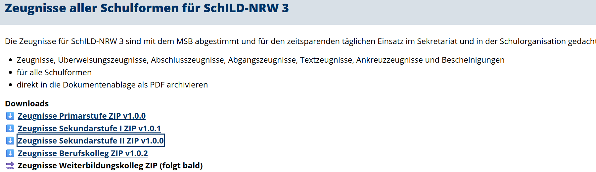

Beachten Sie, dass der Download eine gepackte Datei ist. Speichern Sie diese Datei in Ihrer Zeugnisstruktur:

Legen Sie die Datei in Ihr Report-Verzeichnis im SVWS-Arbeitsverzeichnis, also zum Beispiel: 

`S:\SVWS-Arbeitsverzeichnis\SchILD-Reports\Zeugnisse\Schuljahr 2025_26_1`

Es ist empfehlenswert, zuerst ein Zeugnisverzeichnis und dort für jedes Schuljahr und Halbjahr einen eigenen Ordner anzulegen - dann haben Sie für jeden Lernabschnitt immer alle damals verwendeten Zeugnisse in genau den verwendeten Einstellungen parat.

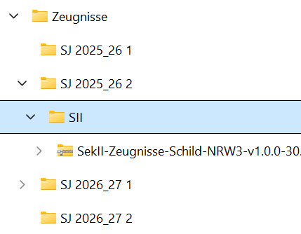

Hier im Beispiel wird auch für die SII in jedem Lernabschnitt ein eigener Ordner erzeugt, so bleiben die Formulare von den Vorgängen der SI getrennt.

Klicken Sie mit der `rechten Maustaste` auf die gepackte Datei, dann wählen Sie `Alle extrahieren...` und entpacken Sie die Anlagen direkt in den gleichen Unterordner in */SVWS-Arbeitsverzeichnis/Schild-Reports*:

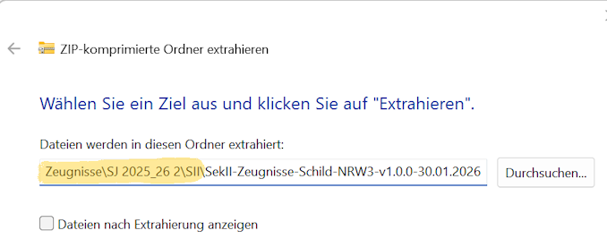

Hier im Beispiel oben wird noch in einen weiteren Unterordner extrahiert, der wie die gepackte Datei heißt. Das ist unübersichtlich und kann optional durch Löschen des neuen Unterordners verhindert werden:

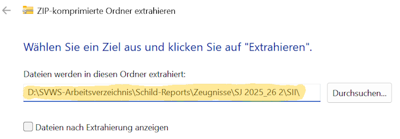

Hier werden die Anlagen direkt in unseren *Lernabschnitts-Ordner für die SII* entpackt und finden sich nun im Unterordner *"GymOb"*:

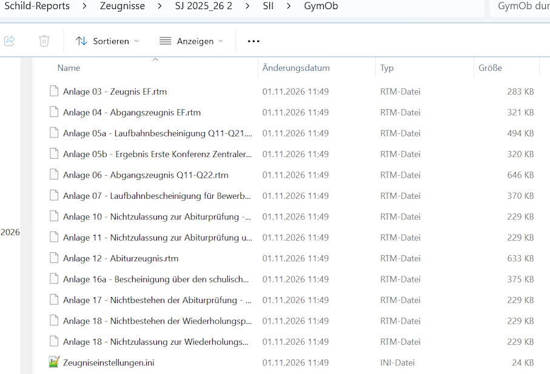

Ein Blick von oben nach unten geht für die beiden Anlangen für die EF, 03 und 04 über die normale Laufbahnbescheinigung für die ersten drei Halbjahre der Q-Phase bis zur Anlage 05b, das Ergebnis des ersten Zentralen Abiturausschusses, der über die Zulassung zur Abiturprüfung entscheidet.

Es folgen die diversen Anlagen zum Abgang in der Q-Phase - dies betrifft auch den Abgang vor der Abiturprüfung - und die unterschiedlichen Nicht-Zulassungen und auch das Abiturzeugnis selbst (Anlage 12) und schließlich die Anlangen, die bei Nicht-Bestehen der Abiturprüfung anzustellen sind; diese unterschieden sich darin, ob Wiederholungen zulässig sind oder nicht.

Ganz unten folgt die *Zeugniseinstellungen.ini*, in der das Aussehen der diversen Anlangen konfiguriert werden kann. In dieser Datei lassen sich die Anlagen über eine Text-Datei konfigurieren.

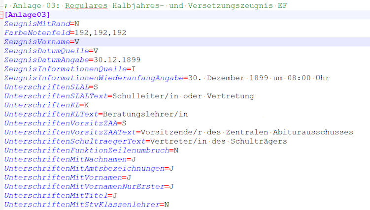

Über die Schalter hinter der jeweiligen Textzeile können Sie steuern, wie die Zeugnisse generiert werden.

Möchten Sie zum Beispiel die Unterschriftenbereieche generell *ohne* Vornamen erzeugen, setzen Sie

`Unterschriften mit Vornamen=N`. 

Ebenso lassen sich die Quellen für die Zeugnisdaten oder andere Daten verändern. Welche Schalter bei welchem Bereich gesetzt werden können, steht unten am Ende der Datei:

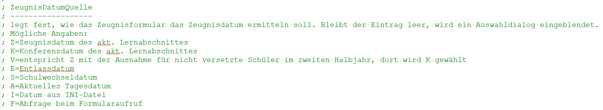

Hierzu gibt es einen ausführlichen Artikel in der Dokumentation zu SchILD-NRW 3.

## Wiederholer

Beachten Sie auch, dass Sie Wiederholer korrekt verplant haben, indem Sie im Reiter **Schüler** und dort in die Leistungsdaten den alten Jahrgang als **Folgeklasse** eintragen.

Achten Sie **nach** dem Schuljahreswechsel noch darauf, dass der alte Lernabschnitt als **2. Durchgang oder höher** und als **nicht gewerteter Abschnitt** markiert ist.

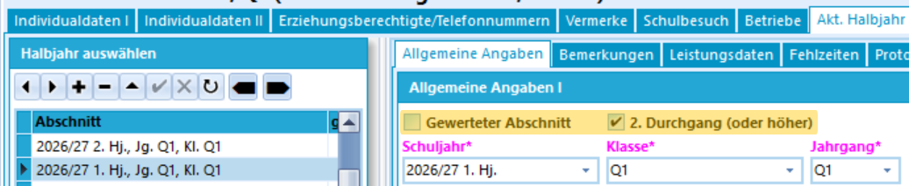

## Abgangsdaten

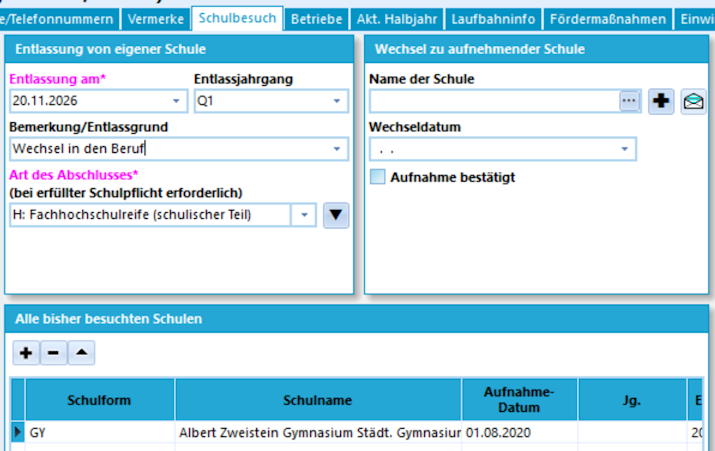

Im Screenshot oben verlässt eine Schülerin der Q1 die Schule und wechselt in den Beruf. Es werden **Entlassung am**, der **Entlassjahrgang** und die **Art des Abschlusses** zwingend gesetzt.

Mit dem kleinen *Pfeil nach unten* ▼ wird die eigene Schule in den Bereich **Alle bisher besuchten Schulen** geschoben.

::: tip Sprachenfolge beachten
Achten Sie besonders bei mittem im Schuljahr oder am Ende "vor dem Zeugnisprozess" gehenden Abgängern darauf, dass das Ende der Sprachenfolgen auch korrekt gesetzt ist.
:::

::: tip FHR prüfen
Prüfen Sie auch, ob ein FHR erreicht wurde!
:::

Drucken Sie nun das korrekte Zeugnis, hier wäre das die *Anlange 06 - Abgangszeugnis Q11-Q22.rtm*, da zwar ein FHR erreicht wurde - haben Sie darauf geprüft? - aber nicht das Ziel des Bildungsganges erreicht wurde (Abitur).

## Druck der Anlagen & Ausschulen von Abgängern

### Zeugnisdruck

Wählen Sie die gwünschte Schülermenge aus und drucken Sie die korrekten Anlagen.

Beim Wechseln der EF zur Q1 könnte es sich empfehlen, zuerst die Abgänger zu verarbeiten und auszuschulen, um dann im Anschluss alle Versetzten zu drucken. Diese werden dann mit dem Schuljahreswechsel versetzt. 

Hier im Beipiel wird die Abgängerin der Q-Phase im Schülercontainer angewählt. Haben Sie weitere Abgänger, wählen Sie alle per Haken an.

Nun wird die **Reportverwaltung** geöffnet und die *Anlage 04 - Abgangszeugnis EF* gedruckt. Diese wurde zuvor über die Zeugniseinstellungen.ini wie gewünscht konfiguriert.

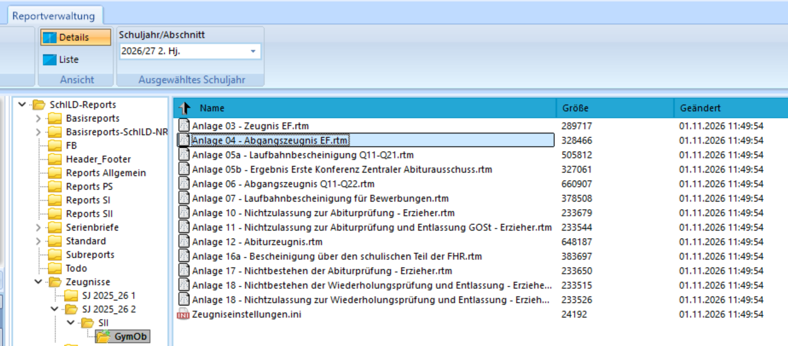

Starten Sie den Druck mit einem `Doppelklick`. 

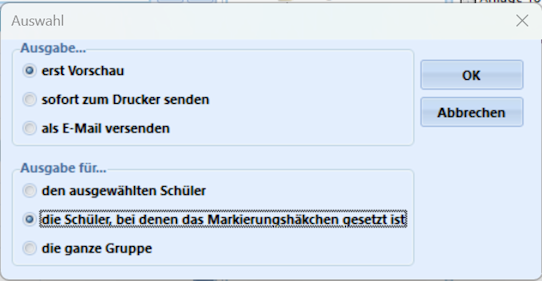

Entscheiden Sie, ob Sie die Zeugnisse auf den *Drucker* schicken wollen oder erst einmal nachschauen, wie die Zeugnisse aussehen werden (*erst Vorschau*).

Wählen Sie auch, ob Sie nur die aktive Person, mehrere Angehakte oder die ganze Gruppe verarbeiten wollen.

Im Anschluss werden Ihre Zeugnisse generiert, die nun zu unterschreiben und zu siegeln sind.

### Ausschulung

Schulen Sie die Schüler aus. Hierbei sind die Daten für den Schulbesuch schon zuvor gesetzt worden. Sie müssen nun den **Status** der Schüler auf *Abschluss* oder *Abgang* setzen.

Dies können Sie direkt in den *Individualdaten* vornehmen.

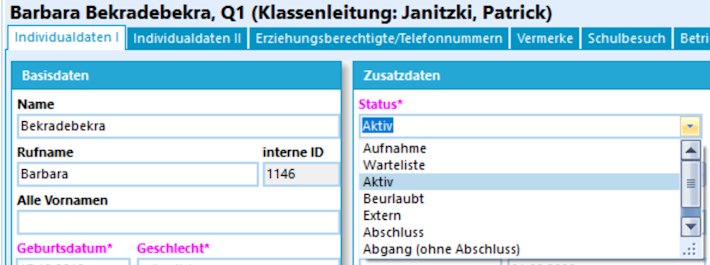

Nachdem der Status verändert wurde, sind die Schüler und Schülerinnne nicht mehr *Aktiv* in Ihren Jahrgängen vorhanden.

Je nach Einstellung in SchILD müssen sowohl der Quell- als auch der Zielstatus im Schülercontainer angewählt sein.

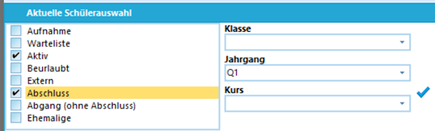

Hier im Beispiel können nun Schüler von *"Aktiv"* auf *"Abschluss"* gestellt werden.

#### Ausschulung per Gruppenprozess

Die Punkte oben werden für größere Schülergruppen per Gruppenprozess ausgeführt:

* Unter **Gruppenprozesse ➔ Noten/Zeugnisvorbereitung** wird das `Konferenz-/Zeugnisdatum` gesetzt.
* Über **Gruppenprozesse ➔ Allgemein** können Sie die `Eigene Schule in Abgangsliste setzen`.
* Mit **Gruppenprozesse ➔ Noten/Zeugnisvorbereitung** `Zeugnisse drucken und Schüler ausschulen` können Sie eine Schülergruppe, die eine Anlage gemeinsam haben (also zum Beispiel alle Abgänger eines Jahrgangs oder alle mit Abitur) im Block drucken und ausschulen.

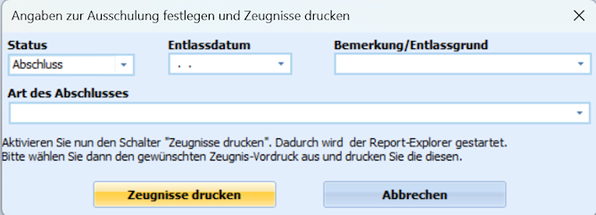

Setzen Sie den neuen *Status*, ein *Entlassdatum*, *Entlassgrund* und *Art des Abschlusses* für eine ganze Gruppe im Schülercontainer.

Im Anschluss klicken Sie auf `Zeugnisse drucken`, gehen in die **Reportverwaltung** und drucken Ihre Anlange wie oben beschrieben.

Im Anschluss sind die Schüler gedruckt & wie eingestellt ausgeschult.

::: tip
Denken Sie daran, dass Sie die Schüler dann nicht mehr in der Auswahl *Status: Aktiv* haben. Wollen Sie anschließend noch digitale Kopien der Zeugnisse ins Zeugnisarchiv oder die Dokumentenverwaltung legen, müssen Sie diese über den **Schülerfilter** im Reiter **Auswahl** wiederholen.

Filtern Sie dazu auf *Status: Abschluss* oder *Status: Abgang* im aktuellen Lernabschnitt und Jahrgang. 
:::

## Archivierung

Denken Sie daran, dass gedruckte Zeugnisse, besonders *Abschlusszeugnisse* und *Abgangszeugnisse* zu archivieren sind.

Hier sind Dopplungen zu drucken und im Ordner im Schularchiv abzulegen.

Sie können auch zusätzlich eine Dopplung als PDF erzeugen und digital abzulegen. Dies können Sie auch für alle gedruckten Zeugnisse vornehmen.

Haben Sie die **Dokumentenverwaltung** und das **Zeugnisarchiv** in den Report-Einstellungen von SchILD-NRW 3 aktiviert, stehen diese Optionen hier im Druckdialog mit zur Verfügung.

::: tip Löschfristen beachten
Beachten Sie hier die jeweils geltenden Löschfristen für analoges und digitales Archivgut.
:::
