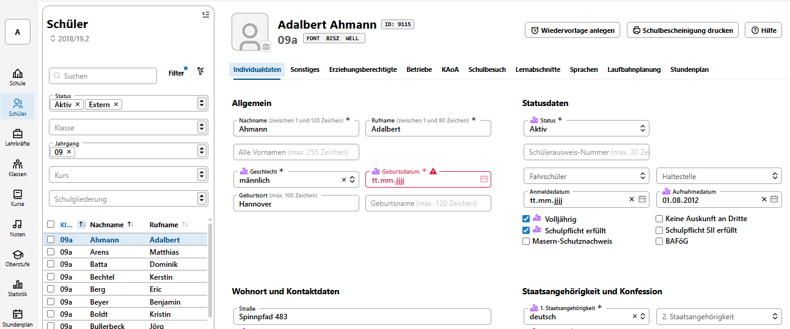

# Der SVWS-Client

Über den SVWS-Client erreichen Sie den Datenbestand Ihrer Schule. Er wird über einen **Internetbrowser** ausgeführt.

## Starten Sie den SVWS-Client

**So starten Sie den SVWS-Client:** Bitten Sie Ihre zuständige IT, ein Icon mit dem Link auf den SVWS-Client auf Ihrem Desktop abzulegen. Starten Sie den Client dann mit einem Doppelklick.

::: tip SVWS-Client ohne Icon aufrufen
Sofern Sie kein Icon auf dem Desktop haben, klicken Sie links im Inhaltsverzeichnis auf `Bedienung im Browser`. Direkt oben in diesem Artikel wird erläutert, wie der SVWS-Client auch ohne Icon erreichbar ist.
:::

**Wenn der Client startet:** Im aufgerufenen Fenster loggen Sie sich mit Ihrem Datenbankbenutzer und dem Passwort ein.

Auf der linken Seite im Screenshot sehen Sie die unterschiedlichen Arbeitsbereiche des SVWS-Clients, die hier **"Apps"** genannt werden. Mit diesen Verwalten Sie Ihre Schule, die Schülerschaft, die Lehrkräfte und so weiter.

Der SVWS-Client arbeitet auf Basis des SVWS-Servers. Alle Änderungen über den SVWS-Client stehen damit wechselseitig anderen Client-Anwendungen zur Verfügung, die auf den SVWS-Server zugreifen.

## Verwendung dieser Dokumentation

Nutzen Sie das Inhaltsverzeichnis auf dieser Webseite (links), um die Dokumentation des SVWS-Clients zu erreichen.

Nehmen Sie in der Kopfzeile unter **Benutzerhandbücher v** auch die Handbücher zu den *SVWS-Tools* zur Kenntnis.

---

>[!TIP]Verwaltungsnetz
>Bezüglich des Datenschutzes ist zu beachten, dass der SVWS-Server mit dem SVWS-Client nur aus dem Verwaltungsnetz zu erreichen sein soll. Möchten Sie einen Zugriff von außen ermöglichen, müssen Sie zu anderen, modernen Standards entsprechenden Maßnahmen greifen. Kontaktieren Sie hierzu bei Bedarf Ihre IT.

Hier eine Übersicht aller [Geschäftsprozesse](geschaeftsprozesse.md) des SVWS-Servers und SVWS-Clients.
