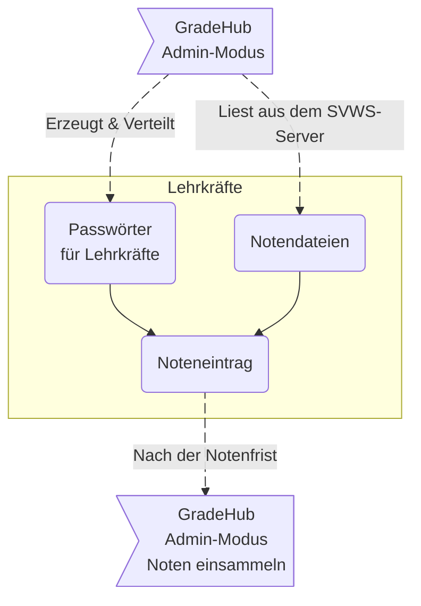

# Das externe Notenmodul SVWS-GradeHub

Mit dem externen **Notenmodul für Lehrkräfte SVWS-GradeHub** lassen sich Noten über Lehrkraftdateien einsammeln und anschließend wieder über den SVWS-Client einlesen.

Das Notenmodul läuft für sich vollständig isoliert auf einem lokalen Rechner und verfügt über keine direkte Verbindung zum SVWS-Server. Der Datenaustausch findet ausschließlich über exportierte Notendateien statt.

SVWS-GradeHub stellt ein Basispaket für das Erfassen von Leistungsdaten dar. Für den vollen Leistungsumfang ist der **SVWS-WebNotenManager (WeNoM)** vorgesehen.

SVWS-GradeHub hat für die Administration einen alternativen SVWS-Server-Modus, mit dem sich *schulische Administratoren* direkt mit dem SVWS-Server verbinden können, um Notendateien zu erzeugen oder einzulesen oder einen Emailversand nutzen können.

Also in Kürze: 

Im *Lehrkraft-Modus*: Der SVWS-GradeHub dient Lehrkräften dazu, Ihre Noten einzutragen und wieder als Lehrkraft-Notendatei zu speichern.

Im *Schul-Admin-Modus* kann SVWS-GradeHub weiterhin
* Passwörter für Notendateien generieren
* Notendateien erzeugen
* Notendateien importieren

>[!TIP]Der SVWS-Client und SVWS-GradeHub
>Der SVWS-Client kann auch Notendateien erzeugen.
>In Kürze erzeugt GradeHub immer verschlüsselte Dateien, die nur über SVWS-GradeHub verarbeitet und wieder eingelesen werdern können. Der SVWS-Client erzeugt unverschlüsselte Notendateien, die in SVWS-GradeHub verarbeitet und über den SVWS-Client wieder eingelesen werden können.
>Entnehmen Sie weitere Hinweise den Kapiteln zur Administration.

::: tip Abgrenzung zum großen SVWS-WeNoM
Im Gegensatz zum **WebNotenManager WeNoM** ist die Komplexität vom SVWS-GradeHub geringer. Es muss für SVWS-GradeHub kein Webserver aufgesetzt werden und die Verbindung zum und vom SVWS-Server muss nicht konfiguriert oder synchronisiert werden. Jedoch fehlt auch die Möglichkeit zum automatischen Austausch über die Server, so dass mit SVWS-GradeHub eine Datei von einer Lehrkraft eigenständig ausgefüllt und wieder in der Schule zur Verfügung gestellt werden kann.
:::

>[!CAUTION] Nicht kompatibel mit SchILD-ENM 2 oder 3
>GradeHub und die Notendateien des SVWS-Clients sind nicht kompatibel mit dem ENM2 von SchILD-NRW2 und ebenso nicht kompatibel mit dem SchILD-NRW-3 ENM3.
>Für das Externe Notenmodul SVWS-GradeHub erstellen Sie die Notendateien bitte mit dem SVWS-Client oder mit SVWS-GradeHub selbst.

