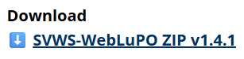

# SVWS-WebLuPO Installation

:::tip Installation durch eine IT
Die Installation und ein Update von SVWS-WebLuPO auf dem Webspace wird in der Regel durch die IT des Schulträgers vorgenommen.
:::

SVWS-WebLuPo ist ein webbasiertes Laufbahnberatungs- und Planungstool für die gymnasiale Oberstufe in NRW.

Laden Sie **SVWS-WebLuPo** auf der [Seite des MSB für Schulverwaltungssoftware](https://www.svws.nrw.de/) im Bereich **SVWS-Tools** herunter.

::: tip Anwenderhandbuch
Die Beschreibung und Benutzung des Tools für Anwender ist unter den Benutzerhandbüchern [WebLuPO Handbuch](weblupo_handbuch.md) zu finden.
:::

## Systemvoraussetzungen

Für die Bereitstellung des Clients ist ein *einfacher Webspace* ausreichend, ohne Datenbankanbindung oder PHP.

## Installation per zip download

Die aktuelle `SVWS-Laufbahnplanung-x.y.z.zip` wird über die oben verlinkte Webseite des MSB herunterzuladen. "x.y.z" steht hierbei für die aktuelle Version.



Entpacken Sie diese Datei im Webverzeichnis Ihres Hosters.

Hier ist ein Beispiel für ein Debian 12 mit Apache2 als Webserver:

```bash
cd /var/www/html/
wget https://github.com/SVWS-NRW/SVWS-Server/releases/download/v0.8.8/SVWS-Laufbahnplanung-0.8.8.zip
unzip SVWS-Laufbahnplanung-0.8.8.zip
```

## Aktualisieren per zip-Download

Die Dateien müssen lediglich ersetzt werden. Um sicher zu gehen, empfiehlt es sich, zuvor die alten Dateien zu entfernen.

Hier ist ein Beispiel für ein Debian 12 mit Apache2 als Webserver:

```bash
rm -rf /var/www/html/*
cd /var/www/html/
wget https://github.com/SVWS-NRW/SVWS-Server/releases/download/v0.8.8/SVWS-Laufbahnplanung-0.8.8.zip
unzip SVWS-Laufbahnplanung-0.8.8.zip
```

## Setzen eines Impressums und Hinweise zum Datenschutz

Wenn SVWS-WebLuPO im freien Internet zu erreichen ist, ist ein Impressum zu setzen.

Erzeugen Sie hierzu eine Datei *Impressum.md* - achten Sie auf das große "I" - auf der *Root-Ebene* des Webservers und befüllen Sie diese Datei mit Ihren Daten.

In einer solchen .md-Datei werden Absätze als Zeilenumbruch aufgefasst.

Ebenso können Sie einen eigenen Datenschutz-Hinweis einfügen, indem Sie eine Datei *Datenschutz.md* anlegen und entsprechend ausfüllen.